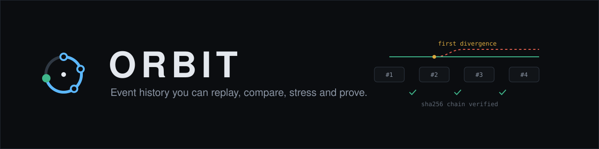
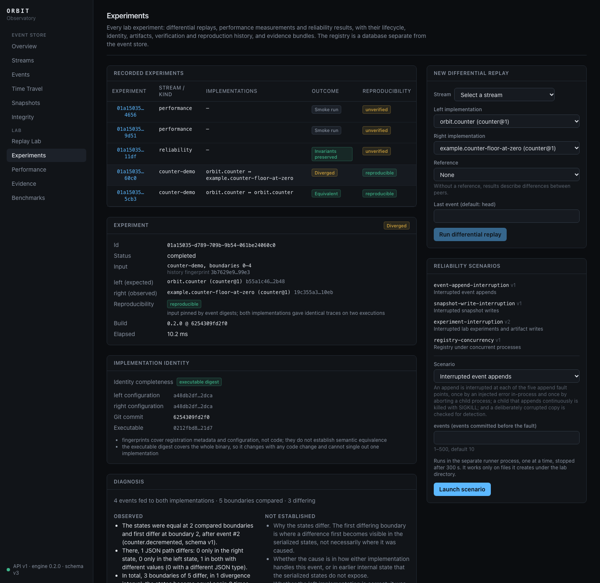
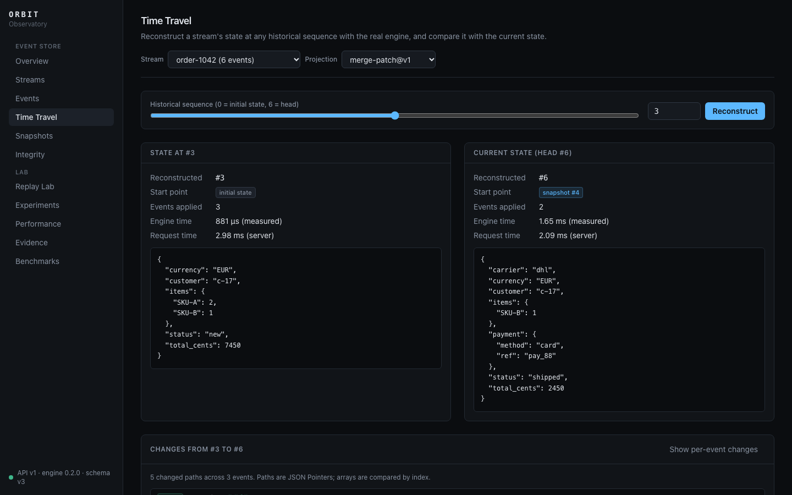
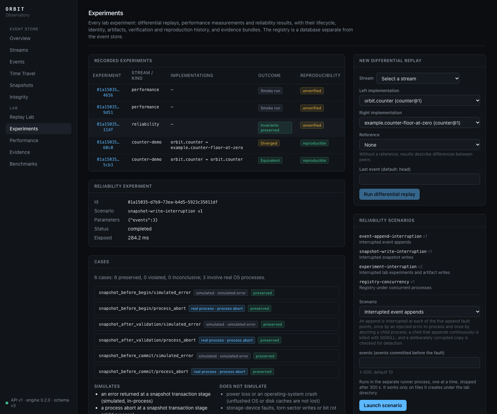
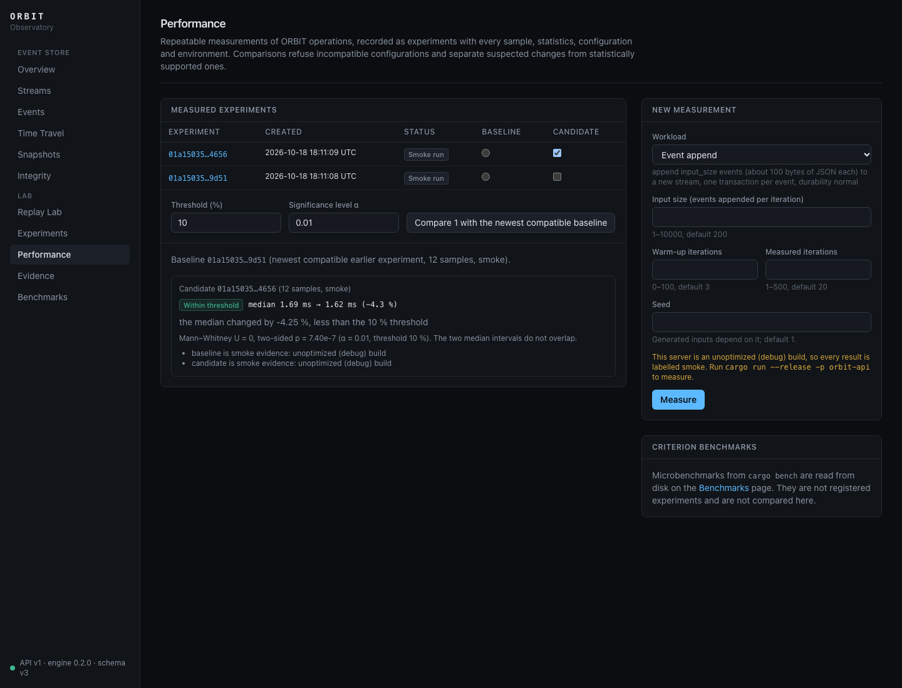
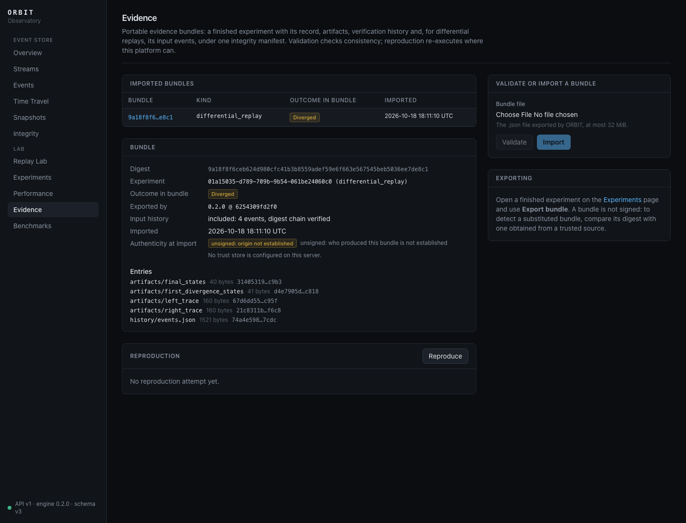
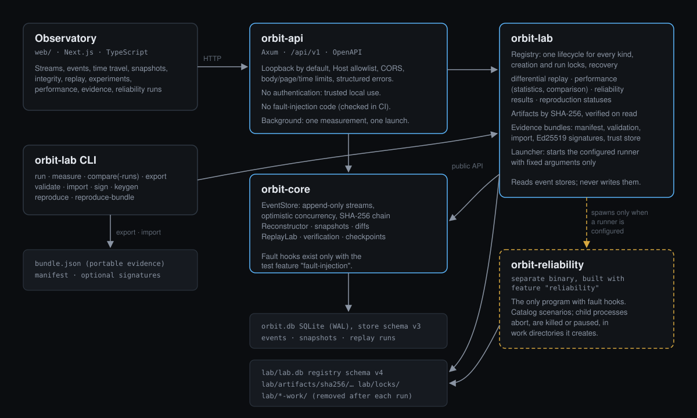

<p align="center">
  
</p>

<p align="center">
  <a href="https://github.com/soyebmohammad03-dev/orbit/actions/workflows/ci.yml"></a>
  <a href="https://github.com/soyebmohammad03-dev/orbit/releases"></a>
  <a href="LICENSE"></a>
  <a href=".github/workflows/ci.yml"></a>
</p>

<p align="center">
  <a href="#quick-start">Quick start</a> ·
  <a href="#architecture">Architecture</a> ·
  <a href="#documentation">Documentation</a> ·
  <a href="#testing-and-evidence">Testing</a> ·
  <a href="#security-model-and-limitations">Security model</a>
</p>

**ORBIT is an append-only event store with a laboratory built on top of it.**
It records what happened to a system as ordered, hash-chained event streams
in SQLite. From those streams it reconstructs any historical state, replays
two implementations side by side to find exactly where they diverge, stresses
its own storage with real process crashes, measures its operations with
honest statistics, and packages the results as portable, verifiable evidence.

It is written in Rust, with an Axum HTTP API and a Next.js interface, the
**Observatory**. Everything runs locally: no services, accounts or paid APIs.
The current release is **v0.2.0** ([release status](#project-status)).

<p align="center">
  
</p>

## Contents

- [Why ORBIT](#why-orbit)
- [What it does](#what-it-does)
- [Architecture](#architecture)
- [Quick start](#quick-start)
- [Testing and evidence](#testing-and-evidence)
- [Security model and limitations](#security-model-and-limitations)
- [Documentation](#documentation)
- [Repository layout](#repository-layout)
- [Project status](#project-status)
- [Contributing and license](#contributing-and-license)

## Why ORBIT

When a system misbehaves, its current state rarely explains how it got there.
An event store keeps every change as an immutable, ordered fact, but that is
only useful if the history can be trusted and interrogated:

- **Was it altered?** Every event is chained to the previous one with
  SHA-256, so damage and edits are detected and located.
- **What did it look like at step N, and what changed?** Any historical
  state can be rebuilt (from a validated snapshot when one exists), diffed,
  and attributed to the events that caused each change.
- **Does a new implementation agree with the old one?** Differential replay
  folds both over the same verified history and reports the first boundary
  where their states differ, every divergence interval, and what the evidence
  does *not* establish.
- **Does it survive failure?** Reliability scenarios abort, kill and pause
  real processes at named fault points and check what must still hold.
- **Did it get slower?** Performance experiments record every sample and
  refuse to compare incompatible runs or to call noise a regression.
- **Can someone else check this?** Evidence bundles carry an experiment and
  its inputs under an integrity manifest, optionally signed, and can be
  reproduced elsewhere.

## What it does

| | |
|---|---|
| **Event store** (`orbit-core`) | Append-only streams with dense sequences, optimistic concurrency and idempotent retries; a SHA-256 digest chain; integrity diagnostics that name the affected events, and trusted checkpoints. SQLite (WAL), schema v3, upgraded in place from every earlier version. |
| **Time travel** | Reconstruct the state at any sequence with any projection, from the newest *valid* snapshot or by full replay; structural diffs; per-event explanations. Snapshots are bound to the event digest they summarise and validated before use. |
| **Replay** | Recorded replay runs with a per-event state-digest trace, re-executed and classified (exact match, reconverged, diverged, failed, unavailable). |
| **Differential replay** (`orbit-lab`) | Two implementations, one verified history, compared canonically after every event: first divergence with its structural diff, every divergence interval and convergence, a determinism re-run, implementation identity and build fingerprints. |
| **Reliability laboratory** | Four scenarios (interrupted appends, interrupted snapshot writes, interrupted experiments and artifact writes, registry concurrency) with real child processes that abort, are killed with `SIGKILL` or paused. Each case reports expected versus observed invariants. Launchable from the Observatory through a separately built runner. |
| **Performance laboratory** | Seven workloads with warm-up and measured iterations; every sample recorded; distribution-free median intervals; exact Mann–Whitney tests for small samples; comparisons of single runs and of sets of independent runs, with explicit compatibility rules. |
| **Evidence bundles** | One canonical JSON file per experiment: manifest, record, artifacts and input events. Strict, bounded validation; import kept apart from local results; exact reproduction from the bundle alone; optional Ed25519 signatures with an explicit trust store. |
| **Observatory** | Every capability above in a local web interface, backed only by the real API. |

<table>
  <tr>
    <td width="50%"></td>
    <td width="50%"></td>
  </tr>
  <tr>
    <td><b>Time travel</b>: historical and current state, the diff between them, and the events responsible.</td>
    <td><b>Reliability</b>: a scenario run by the separate runner; each case says whether a real process failed.</td>
  </tr>
  <tr>
    <td></td>
    <td></td>
  </tr>
  <tr>
    <td><b>Performance</b>: verdicts with their test and caveats; debug builds are labelled smoke runs.</td>
    <td><b>Evidence</b>: integrity, history and authenticity (unsigned here) reported separately.</td>
  </tr>
</table>

The screenshots are of the real application, after
[`scripts/validate-workflow.sh`](scripts/validate-workflow.sh) created its
records through the API, captured with
[`web/scripts/screenshots.mjs`](web/scripts/screenshots.mjs). More are in
[docs/assets/screenshots](docs/assets/screenshots), including a
[phone-width layout](docs/assets/screenshots/mobile-experiments.png).

## Architecture

<p align="center">
  
</p>

- **`orbit-core`** owns the event store. Only its `store` module knows about
  SQLite; projections never touch storage.
- **`orbit-lab`** holds experiments in its own registry (`lab.db`), separate
  from every event store. It only *reads* event stores, through `orbit-core`'s
  public API. One lifecycle (`created → running → completed | failed`) covers
  every kind, enforced by the database. OS locks detect interrupted and
  abandoned experiments without clocks.
- **`orbit-api`** exposes both over `/api/v1` (OpenAPI 3.1 at
  `/api/v1/openapi.json`). It contains **no fault-injection code**: CI checks
  its feature graph and searches its binary.
- **`orbit-reliability`** is a separately built tool and the only program
  with fault hooks. The API can start it, with fixed arguments, only when
  `ORBIT_RELIABILITY_RUNNER` is configured.

Details: [docs/ARCHITECTURE.md](docs/ARCHITECTURE.md) and the
[architecture decision records](docs/adr).

## Quick start

Prerequisites: stable Rust (tested with 1.99.1), a C compiler (on macOS,
`xcode-select --install`), and Node.js 20.9 or later for the web interface
(tested with 24).

```bash
git clone https://github.com/soyebmohammad03-dev/orbit.git
```

```bash
cd orbit && cargo build && cargo test
```

Run the Observatory (two terminals):

```bash
cargo run -p orbit-api
```

```bash
cd web && npm ci && npm run dev
```

Open <http://localhost:3000>. To fill it with demonstration data through the
API:

```bash
scripts/seed-demo.sh
```

To launch reliability scenarios from the Observatory, build the runner and
point the API at it (it is disabled otherwise):

```bash
cargo build -p orbit-lab --features reliability --bin orbit-reliability
```

```bash
ORBIT_RELIABILITY_RUNNER="$PWD/target/debug/orbit-reliability" cargo run -p orbit-api
```

**Where data lives.** The event store is `data/orbit.db` and the lab is
`data/lab/` (registry, artifacts, locks); both are git-ignored. Every
setting is an `ORBIT_*` environment variable, documented in
[docs/API.md](docs/API.md#running): addresses, CORS origins, allowed hosts,
limits, timeouts, the lab directory, the reliability runner and the trusted
signing keys.

**Without the web interface**, the CLIs do everything:

```bash
cargo run -p orbit-core --example time_travel
```

```bash
cargo run --release -p orbit-lab -- measure historical-reconstruction --iterations 30
```

```bash
cargo run -p orbit-lab -- export <experiment id> --out bundle.json
```

```bash
cargo run -p orbit-lab --features reliability --bin orbit-reliability -- run registry-concurrency
```

A minimal library example:

```rust,no_run
use orbit_core::{AppendRequest, EventStore, EventType, Metadata, StoreConfig, StreamId};
use serde_json::json;

fn main() -> Result<(), orbit_core::StoreError> {
    let store = EventStore::open(StoreConfig::new("orbit.db"))?;
    let stream = StreamId::new("account-42")?;
    store.create_stream(&stream, Metadata::new())?;

    let opened = EventType::new("account.opened")?;
    let event = store.append(&stream, AppendRequest::new(opened, json!({"owner": "alice"})))?;
    assert_eq!(event.sequence.get(), 1);
    assert!(store.verify_stream(&stream)?.is_valid());
    Ok(())
}
```

## Testing and evidence

| Suite | Tests | What it exercises |
|---|---|---|
| `orbit-core` | 173 | Real SQLite files: persistence, constraints run as raw SQL, concurrency across threads and processes, child processes that `abort()` or are killed mid-append, fault points, tamper detection, migrations from real v1/v2 fixtures, and property tests that check reconstruction and replay against independent reference folds |
| `orbit-lab` | 139 | Differential replay against an independent reference, registry lifecycle and recovery (including killed creators), reliability scenarios with real child processes, the launcher's deadline and process-group kill, statistics against independently computed answers, bundle validation, tampering, signatures and committed fixtures |
| `orbit-api` | 53 | The real router: every endpoint's contract, limits, the Host and CORS guards, background runs, reliability launching, bundle routes, and a real TCP server |
| Web unit and component | 46 | The typed API client, formatters and views, with mocked responses |
| End-to-end (Playwright) | 6 | A real `orbit-api` (with the real reliability runner), a production web build and empty databases, in Chromium, including phone-width checks |

Every push runs, on Ubuntu and macOS:
- formatting, `clippy -D warnings` (all features, and the production build
  without them), all tests, docs, and benchmark compilation;
- smoke runs of the examples and a performance workload;
- the fault-isolation checks on `orbit-api`;
- the web checks and production build;
- the end-to-end suite;
- a dependency audit (`cargo audit` against the RustSec database and
  `npm audit` for production dependencies).

[`scripts/validate-workflow.sh`](scripts/validate-workflow.sh) drives every
subsystem through the public API and CLIs on a fresh data directory: 43
checks, including a restart and checks that no process, work directory, temp
file or lock file is left behind. It passed for this release.

**Measurements are not guarantees.** The numbers in
[docs/PERFORMANCE.md](docs/PERFORMANCE.md) are labelled as smoke runs,
single-run measurements, or comparisons of independent runs, with machine
and build. Reliability results show that the listed invariants held for the
listed failures on the machines that ran them; they do not cover power loss,
OS crashes or storage faults ([docs/RELIABILITY.md](docs/RELIABILITY.md)).

## Security model and limitations

- **Local use only.** The API has **no authentication**. It binds to
  `127.0.0.1`, refuses non-loopback addresses unless explicitly allowed,
  checks the `Host` header (DNS-rebinding defence), allows CORS only for
  configured origins, and bounds bodies, pages, ranges and request time. Do
  not expose it to a network.
- **Fault injection never reaches the production API.** See
  [Architecture](#architecture).
- **Digests are unkeyed.** They detect damage and naive edits. Someone who
  can rewrite the database can recompute them; checkpoints kept elsewhere
  detect that up to the checkpoint.
- **Bundles are tamper-evident, not self-authenticating.** Any change
  changes the bundle digest, but anyone can build a consistent bundle.
  Signatures count only for keys in a trust store you configure; unsigned
  and untrusted bundles are labelled as such everywhere.
- **Durability under power loss or OS crashes is not independently
  tested.** It rests on SQLite and the device.

The full threat model and every known limitation:
[SECURITY.md](SECURITY.md), [docs/RECOVERY.md](docs/RECOVERY.md) and the
limitation sections of [LAB](docs/LAB.md#known-limitations),
[RELIABILITY](docs/RELIABILITY.md), [PERFORMANCE](docs/PERFORMANCE.md#limitations)
and [EVIDENCE](docs/EVIDENCE.md#limits-and-limitations).

## Documentation

| Topic | Document |
|---|---|
| Architecture, data flow, design decisions | [ARCHITECTURE](docs/ARCHITECTURE.md), [ADRs](docs/adr) |
| Event model, storage format, recovery and integrity | [EVENT_MODEL](docs/EVENT_MODEL.md), [STORAGE_DESIGN](docs/STORAGE_DESIGN.md), [RECOVERY](docs/RECOVERY.md) |
| Reconstruction, snapshots, replay | [RECONSTRUCTION](docs/RECONSTRUCTION.md), [SNAPSHOTS](docs/SNAPSHOTS.md), [REPLAY](docs/REPLAY.md) |
| Experiments, differential replay, reproduction | [LAB](docs/LAB.md) |
| Reliability scenarios and the runner | [RELIABILITY](docs/RELIABILITY.md) |
| Performance method, statistics, recorded results | [PERFORMANCE](docs/PERFORMANCE.md) |
| Evidence bundles, signatures, trust | [EVIDENCE](docs/EVIDENCE.md) |
| HTTP API and configuration | [API](docs/API.md) |
| The Observatory | [OBSERVATORY](docs/OBSERVATORY.md) |
| Development, tests, CI, benchmarks | [DEVELOPMENT](docs/DEVELOPMENT.md) |

## Repository layout

```text
crates/
  orbit-core/      event store, reconstruction, snapshots, replay, integrity (lib, tests, benches, examples)
  orbit-lab/       registry, differential replay, performance, reliability, bundles, signing
                   bins: orbit-lab (CLI), orbit-reliability (runner; feature "reliability")
  orbit-api/       Axum HTTP API
web/               Observatory (Next.js): src/app pages, src/lib typed client, tests/unit, tests/e2e
scripts/           seed-demo.sh, validate-workflow.sh
docs/              design and reference documents, adr/, assets/ (brand, architecture, screenshots)
.github/workflows/ CI: Rust on Linux and macOS, web, end-to-end, dependency audit
```

## Project status

ORBIT is complete in the scope it set out to cover, and v0.2.0 is its
current release. It stays below 1.0 deliberately:

- the Rust library and HTTP APIs have no stability or deprecation policy;
- it is a local, single-host tool (one SQLite writer, no authentication);
- it has been tested on macOS and on GitHub's Ubuntu and macOS runners, not
  on Windows.

The history of how it was built, phase by phase, is in
[CHANGELOG.md](CHANGELOG.md).

## Contributing and license

See [CONTRIBUTING.md](CONTRIBUTING.md) for the development workflow and what
a change needs (tests, documentation, honest claims), and
[SECURITY.md](SECURITY.md) to report a vulnerability. Licensed under the
[MIT License](LICENSE).
