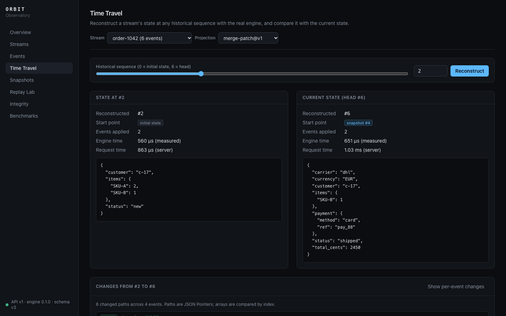

# ORBIT

**ORBIT is a persistent event store being built toward a time-travel
debugging platform.** It records what happened to a system as ordered,
append-only, integrity-checked event streams. From those streams it
reconstructs, compares and deterministically replays historical state.

> **Status: Phases 1–4 of 5 are complete.** Phase 1 is the core event engine
> and persistence. Phase 2 is historical state reconstruction, snapshots and
> state diffs. Phase 3 is crash recovery, concurrency guarantees, integrity
> diagnostics and deterministic replay. Phase 4 is the **Observatory**: a local
> HTTP API and a web interface over the real engine. Phase 5 (release
> hardening) is planned. ORBIT is pre-release, the API may change, and it is not
> production-ready.



## Problem

When a system misbehaves, its current state rarely explains how it got there.
Logs are lossy, unordered across components, and easy to change after the
fact. An event store keeps every state change as an immutable, ordered fact.
With that foundation you can answer "what did this look like at step N, and
what changed?" Answering that reliably requires a trustworthy foundation: dense
ordering that never depends on wall clocks, atomic durable appends, and a way
to detect stored history that has been damaged or altered. Phase 1 builds that
foundation. Phase 2 answers the question itself: it reconstructs any historical
state, diffs two of them, and names the events responsible for each change.

## Implemented in Phase 1

- **Streams.** Explicit creation with immutable metadata, existence checks,
  and head inspection.
- **Append-only events.** Atomic appends assign dense sequence numbers
  (1, 2, 3, …). An empty stream has head 0.
- **Optimistic concurrency.** `ExpectedSequence::Exact(n)` rejects stale
  writers with a typed `SequenceConflict`.
- **Reads.** A single event by sequence, a whole stream, or pages of events
  after a sequence, always in sequence order.
- **Durable SQLite persistence.** WAL mode, configurable durability (`Full`
  by default, including `F_FULLFSYNC` on macOS), and versioned migrations.
  Constraints and triggers enforce the invariants in the database itself.
- **Integrity verification.** Payloads are stored as canonical JSON. Each event
  carries a SHA-256 digest chained to the previous event's. `verify_stream`
  reports digest mismatches, chain breaks, gaps, malformed rows and head
  mismatches, each with its sequence number.
- **Validation and typed errors.** Every input is validated at the boundary.
  No panics on bad input or damaged files.
- **Configuration** in code or through `ORBIT_*` environment variables.

## Implemented in Phase 2

- **Projections.** A small `Projection` trait: an initial state and a fallible
  `apply`. Errors are typed as unsupported, invalid payload, or rejected
  transition. Two example projections are included: `Counter`, and a nested
  `Inventory`.
- **Historical reconstruction.** State at `Target::Latest` or any
  `Target::At(n)`, folded in bounded pages, in sequence order. It fails
  explicitly on a projection error. There are never partial results.
- **Snapshots.** Persisted, digest-protected and bound to the digest of the
  event they were built on. Saving is idempotent. Each snapshot is validated
  before use: integrity, history binding, projection key, and decodability.
- **Snapshot-assisted reconstruction.** Uses the newest valid compatible
  snapshot at or before the target. The policy is `Prefer` (skip and report
  invalid snapshots), `Strict`, `Exact(id)` or `Ignore`. Results can be
  checked against full replay.
- **State diffs.** A structural JSON diff with RFC 6901 paths: added, removed
  and modified, in deterministic order. It runs between any two historical
  positions.
- **Provenance.** Serializable reconstruction reports: start point, events
  applied, rejected snapshots, and timing. `explain` attributes every change
  to the event that caused it.

## Implemented in Phase 3

- **Recovery guarantees, tested by fault injection.** Every write is one
  transaction. Deterministic fault points at each transaction boundary (the
  `fault-injection` cargo feature, off by default) show that no failed
  operation leaves committed state. Real child-process crashes (`abort()` at
  chosen points, and `SIGKILL` during appends) show that reopening recovers
  every committed event and nothing else. Power loss is *not* simulated.
- **Concurrency invariants under stress.** Multi-connection and multi-process
  tests run blind writers, optimistic writers with retry, readers and
  snapshotters at once. They check that streams stay dense, that every
  acknowledged append is stored exactly once, that conflicts are reported
  correctly, and that snapshots are consistent.
- **Integrity diagnostics.**
  - `verify_store` runs SQLite's integrity check and covers foreign keys,
    missing protective triggers, every stream, snapshot and replay run.
  - Issues are categorised (modified event, broken chain, invalid genesis,
    sequence continuity, head inconsistency, …) and name the affected event ids.
  - **Trusted checkpoints** detect even a history rewritten with recomputed
    unkeyed digests.
  - `StoreError::class()` separates retryable failures from integrity violations.
- **Deterministic replay.** `ReplayLab` records self-contained replay runs
  (schema v3) with a per-event state-digest trace, re-executes them with the
  current projection, and persists every execution.
- **Divergence detection.** Outcomes are classified as exact match,
  reconverged, diverged, projection failed, unavailable (for example a
  projection version mismatch, which is never substituted), invalid input, or
  integrity failure. ORBIT reports the first event after which the state
  diverged, and the final-state diff.
- **Experiments.** `ReplayLab::experiment` produces one structured report:
  integrity, snapshot-assisted versus full replay, the replay outcome, state
  digests and timings.

## Implemented in Phase 4: the Observatory

- **`orbit-api`.** An Axum server exposing `/api/v1`: health and
  capabilities, streams and paged events, appends with optimistic concurrency,
  reconstruction at any sequence, structural diffs, per-event explanations,
  snapshots with live validation, checkpoints, stream and store verification,
  replay runs, executions and experiments, and Criterion results.
  - Engine calls run in `spawn_blocking`, and errors use one structured
    envelope with proper status codes.
  - The OpenAPI 3.1 document is generated from the handlers.
  - It binds to localhost, with narrow CORS and bounded inputs.
  - See [docs/API.md](docs/API.md).
- **Web Observatory (`web/`).** Next.js App Router, strict TypeScript and
  Tailwind, in a dark-first console design. It has eight working pages:
  Overview, Streams, Events, Time Travel, Snapshots, Replay Lab, Integrity and
  Benchmarks. All data comes from the real API, with loading, empty, error and
  retry states. See [docs/OBSERVATORY.md](docs/OBSERVATORY.md).
- **Core additions.**
  - A general-purpose `merge-patch@v1` projection (RFC 7386), so any JSON
    stream can be reconstructed and diffed.
  - Stream summaries, store statistics and a recent-activity query.

## Tests

| Suite | Count | Runs against |
|-------|-------|--------------|
| `orbit-core` unit + integration + doc | 44 + 126 + 4 | real SQLite files (126 includes 9 property tests and 2 child-process entry points) |
| `orbit-api` unit + HTTP contract + TCP | 5 + 16 + 1 | the real router and engine on temporary databases |
| Web unit and component (Vitest) | 21 | the API client, components and the Overview page, with mocked responses |
| End-to-end (Playwright) | 2 | a real `orbit-api` + production web build + an empty temporary SQLite file |

Criterion suites cover the event store, reconstruction, and Phase 3's
concurrency, verification, replay and failure paths.

## Architecture

```text
web/ (Next.js) ──HTTP /api/v1──▶ crates/orbit-api (Axum) ──spawn_blocking──▶ crates/orbit-core ──▶ SQLite

crates/orbit-api
├── routes       thin handlers: validate → engine call → DTO/report
├── engines      DynEngine: runtime projection selection over Reconstructor/ReplayLab
├── dto, error   request/response types, structured error envelope
└── openapi      generated OpenAPI 3.1 document

crates/orbit-core
├── domain       validated ids, Stream, AppendRequest, StoredEvent, canonical JSON
├── store        EventStore: events, snapshots, schema/migrations (SQLite)
├── integrity    event digest construction, chain verification, IntegrityReport
├── projection   Projection trait, ProjectionError, example projections
├── reconstruct  Reconstructor: historical state, snapshot use, diff, explain
├── snapshot     snapshot types, snapshot digest, validation outcomes
├── diff         structural JSON diff
├── replay       ReplayLab: replay runs, executions, divergence, experiments
├── fault        fault points (hooks with the `fault-injection` feature)
├── config       StoreConfig, Durability, Limits, env loading
└── error        StoreError, ErrorClass, ValidationError
```

Only `store` knows about SQLite. Projection logic never touches storage, and
reconstruction reaches the database only through `EventStore` methods. For component diagrams and the append data flow, see
[docs/ARCHITECTURE.md](docs/ARCHITECTURE.md).

## Technology

Rust (stable, edition 2024) · SQLite (bundled) through `rusqlite` · `serde` /
`serde_json` · `sha2` · `uuid` (v7) · `chrono` · `thiserror` · `tracing`.
The API uses Axum 0.8, Tokio, tower-http and utoipa. The web app uses Next.js 16
(App Router), React 19, TypeScript (strict) and Tailwind CSS 4. Tests use
`proptest`, `tempfile`, Vitest, Testing Library and Playwright. Benchmarks use
`criterion`. ORBIT needs no services, hosted databases or paid APIs. Why `rusqlite` rather than `sqlx` is
explained in [ADR 0001](docs/adr/0001-sqlite-via-rusqlite.md).

## Getting started

Prerequisites: stable Rust (tested with 1.99.1), a C compiler (on macOS,
`xcode-select --install`), and Node.js ≥ 20.9 for the web interface (tested
with 24).

```bash
git clone https://github.com/soyebmohammad03-dev/orbit.git && cd orbit
cargo build
cargo test
```

### Run the Observatory

```bash
cargo run -p orbit-api                 # API on http://127.0.0.1:7878 (database: data/orbit.db)
cd web && npm ci && npm run dev        # UI on http://localhost:3000, in a second terminal
scripts/seed-demo.sh                   # optional demonstration data, through the API
```

The API's contract is served at `http://127.0.0.1:7878/api/v1/openapi.json`.
Configuration is described in [docs/API.md](docs/API.md#running).

### Library examples

```bash
cargo run -p orbit-core --example quickstart
cargo run -p orbit-core --example time_travel
cargo run -p orbit-core --example crash_lab
```

### Minimal example

```rust,no_run
use orbit_core::{AppendRequest, EventStore, EventType, Metadata, Sequence, StoreConfig, StreamId};
use serde_json::json;

fn main() -> Result<(), orbit_core::StoreError> {
    let store = EventStore::open(StoreConfig::new("orbit.db"))?;

    let account = StreamId::new("account-42")?;
    store.create_stream(&account, Metadata::new())?;

    let opened = EventType::new("account.opened")?;
    let event = store.append(
        &account,
        AppendRequest::new(opened, json!({"owner": "alice"})).expect_sequence(Sequence::ZERO),
    )?;
    assert_eq!(event.sequence, Sequence::FIRST);

    for event in store.read_after(&account, Sequence::ZERO, 100)? {
        println!("#{} {} {}", event.sequence, event.event_type, event.payload);
    }

    let report = store.verify_stream(&account)?;
    assert!(report.is_valid());
    Ok(())
}
```

### Time travel

```rust,no_run
use orbit_core::projection::examples::Counter;
use orbit_core::{EventStore, ReconstructOptions, Reconstructor, Sequence, StreamId, Target};

fn time_travel(store: &EventStore, stream: &StreamId) -> Result<(), Box<dyn std::error::Error>> {
    let counter = Reconstructor::new(store, Counter);
    let options = ReconstructOptions::default(); // uses valid snapshots when present

    let then = counter.reconstruct(stream, Target::At(Sequence::new(10)?), options)?;
    println!("value after event 10: {} ({:?})", then.state.value, then.report.start);

    counter.create_snapshot(stream, Target::Latest, options)?;
    let check = counter.compare_with_full_replay(stream, Target::Latest, options.snapshots)?;
    assert!(check.equivalent);

    let diff = counter.diff(stream, Sequence::new(5)?, Sequence::new(10)?, options)?;
    println!("{}", serde_json::to_string_pretty(&diff.changes)?);
    Ok(())
}
```

[docs/RECONSTRUCTION.md](docs/RECONSTRUCTION.md) and
[docs/SNAPSHOTS.md](docs/SNAPSHOTS.md) cover the full semantics.

## Tests, lints and benchmarks

```bash
cargo test --workspace                                 # all Rust tests (core + API)
cargo fmt --all --check
cargo clippy --workspace --all-targets --all-features -- -D warnings
cargo doc --workspace --no-deps
(cd web && npm run format:check && npm run lint && npm run typecheck && npm test && npm run build)
(cd web && npx playwright install chromium && npm run test:e2e)   # end-to-end workflow
cargo bench -p orbit-core --bench event_store          # ~1 minute
cargo bench -p orbit-core --bench reconstruction        # ~1.5 minutes
cargo bench -p orbit-core --bench crash_lab             # ~2 minutes
```

[docs/DEVELOPMENT.md](docs/DEVELOPMENT.md) maps each test to what it covers. It
also has the benchmark workloads and the recorded measurements, labelled with
their hardware and conditions.

## Repository layout

```text
.
├── Cargo.toml                 workspace manifest (shared lints)
├── crates/orbit-api/          Axum HTTP API (src/routes, tests/ contract + TCP tests)
├── web/                       Next.js Observatory (src/app pages, src/lib client, tests/unit, tests/e2e)
├── scripts/seed-demo.sh       demonstration data through the API
├── crates/orbit-core/
│   ├── src/                   library source
│   ├── tests/                 integration and property tests (real SQLite files)
│   │   └── fixtures/          schema v1 and v2 database dumps for migration tests
│   ├── benches/               event_store.rs, reconstruction.rs, crash_lab.rs (Criterion)
│   └── examples/              quickstart.rs, time_travel.rs, crash_lab.rs
├── docs/
│   ├── ARCHITECTURE.md  EVENT_MODEL.md  STORAGE_DESIGN.md  DEVELOPMENT.md
│   ├── RECONSTRUCTION.md  SNAPSHOTS.md  RECOVERY.md  REPLAY.md  API.md  OBSERVATORY.md
│   ├── screenshots/           captured from the running application
│   └── adr/                   architecture decision records
└── .github/workflows/ci.yml   Rust (Linux + macOS), web checks and build, end-to-end workflow
```

## Current limitations

- Single-event appends only. There is no atomic multi-event batch append yet.
- One connection per `EventStore`. Calls through one instance are serialised,
  and SQLite allows one writer per file.
- Digests are **unkeyed**. On their own they detect corruption and naive edits,
  but not an attacker who rewrites the file and recomputes every hash. Trusted
  checkpoints kept outside the database detect such rewrites up to the
  checkpoint. There are no keys or signatures. See
  [RECOVERY.md](docs/RECOVERY.md#integrity-threat-model).
- There is no stream deletion or archival, and no global (cross-stream) ordering.
- Process crashes are tested. OS crashes and power loss are not simulated, and
  durability under them rests on SQLite and the storage device.
- No replication, consensus, or multi-host access. One host, local files.
- Replay runs are capped at 100,000 events. Divergence is localised to the
  first event whose resulting state differs, which is not necessarily its cause.
- The API has **no authentication** and is meant for localhost. It refuses
  non-loopback addresses unless explicitly allowed. All requests share one
  SQLite connection, so it is a local debugging tool, not a multi-user server.
- Projections are compiled in. The API offers `merge-patch`, `counter` and
  `inventory`, and custom projections need a Rust change
  (`crates/orbit-api/src/engines.rs`).
- The UI keeps integrity checkpoints in browser local storage, which is
  per-browser and not shared.
- Benchmark results appear in the UI only after `cargo bench` has produced
  them locally.
- Local files only. The database must not be on a network file system.
- Synchronous API. The future async server will call it through `spawn_blocking`.
- Projections are Rust code compiled into the application. Reconstruction runs
  one stream at a time, and the state must fit in memory.
- There is no automatic snapshot scheduling or pruning. Snapshot digests are
  unkeyed, and a consistent-but-wrong snapshot is only caught by
  `compare_with_full_replay`.
- Array diffs are positional. There is no LCS alignment.

## Roadmap

| Phase | Scope | Status |
|-------|-------|--------|
| 1 | Core event engine and persistence | **done** |
| 2 | Historical state reconstruction, snapshots and state diffs | **done** |
| 3 | Crash recovery, concurrency control, integrity auditing, deterministic replay and divergence diagnostics | **done** |
| 4 | Backend API (Axum) and web observability frontend | **done** |
| 5 | Test hardening, reproducible benchmarks, documentation, release | planned |

Phase 5 is planned work and does not exist yet. That includes release packaging and versioned artifacts.

## Contributing, security, license

See [CONTRIBUTING.md](CONTRIBUTING.md) and [SECURITY.md](SECURITY.md).
Licensed under the [MIT License](LICENSE).
