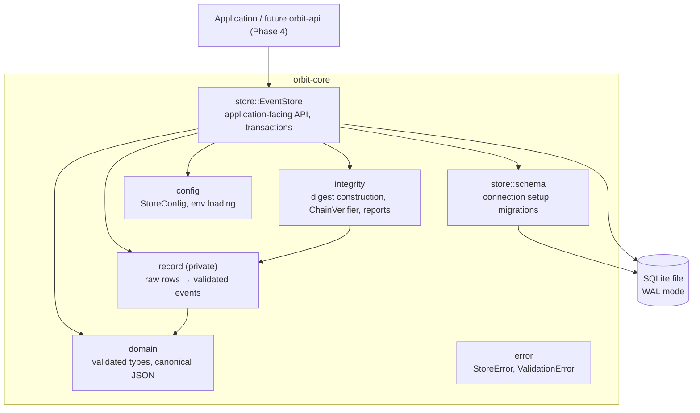
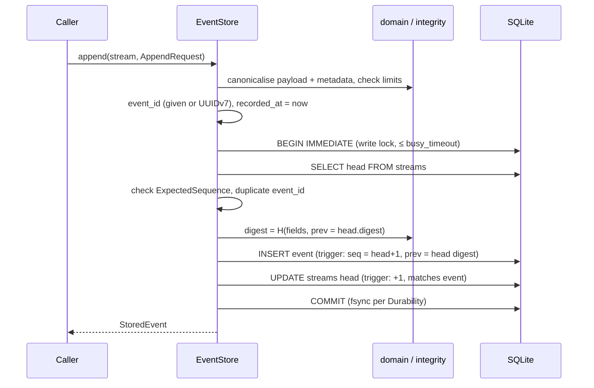

# Architecture

Phase 1 delivers one library crate, `orbit-core`, inside a Cargo workspace
(see [ADR 0003](adr/0003-single-crate-concrete-store.md)).

## Components

| Module      | Responsibility | Depends on SQLite? |
|-------------|----------------|--------------------|
| `domain`    | Identifiers, `AppendRequest`, `StoredEvent`, `Stream`, `Timestamp`, `Digest`, canonical JSON. Every value is validated on construction and deserialization. | no |
| `integrity` | `EventDigestInput::compute` (the digest construction), `ChainVerifier`, `IntegrityReport`. | no |
| `record`    | `RawEventRecord`: a row as stored, and its fully validated decoding. Shared by reads and verification. | no |
| `store`     | `EventStore`: transactions, sequence allocation, queries, error mapping. | yes |
| `config`    | `StoreConfig`, `Durability`, `Limits`, `ORBIT_*` environment variables. | no |
| `error`     | Typed errors. The driver error is wrapped opaquely (`DatabaseError`). | wraps it |

Only `store` touches `rusqlite`, and no `rusqlite` type appears in the public
API. A future backend would need a new `store` implementation, and nothing else
would change.

## Append data flow

Any error drops the transaction, which rolls it back. The exact semantics are in
[STORAGE_DESIGN.md](STORAGE_DESIGN.md#append-transaction).

## Key decisions

| Decision | Record |
|----------|--------|
| SQLite through `rusqlite` with a synchronous API, not `sqlx` | [ADR 0001](adr/0001-sqlite-via-rusqlite.md) |
| Canonical JSON stored and hashed, with a per-stream hash chain | [ADR 0002](adr/0002-canonical-json-and-hash-chain.md) |
| One crate and a concrete store, no storage trait yet | [ADR 0003](adr/0003-single-crate-concrete-store.md) |
| Sequence allocation under `BEGIN IMMEDIATE` | [ADR 0004](adr/0004-sequence-allocation.md) |

Smaller choices:

- **Explicit stream creation.** Appending to an unknown stream is an error,
  not an implicit create. That prevents typos from creating streams.
- **Store-assigned timestamps.** `recorded_at` comes from the store, and only
  `sequence` defines order.
- **Panic-free paths.** Library code avoids `unwrap` and `expect` on anything
  a caller or a damaged file can influence. A poisoned mutex is recovered,
  because rusqlite rolls back open transactions during unwinding.
- **`unsafe_code = "forbid"`** across the workspace.

## Extension points for later phases

- **Phase 2 (reconstruction, snapshots).** Folds over `read_after` pages. The
  snapshot tables become migration 2. `StreamHead.digest` gives snapshots a
  cheap way to bind to an exact stream position.
- **Phase 3 (recovery, concurrency, replay).** `ChainVerifier` already
  separates "invalid data" from "could not verify". Crash testing will exercise
  `Durability`. Read connection pooling can go behind the existing API.
- **Phase 4 (API).** Domain and report types already derive `Serialize` and,
  for requests, validating `Deserialize`. The Axum layer will call the store
  through `spawn_blocking`.
