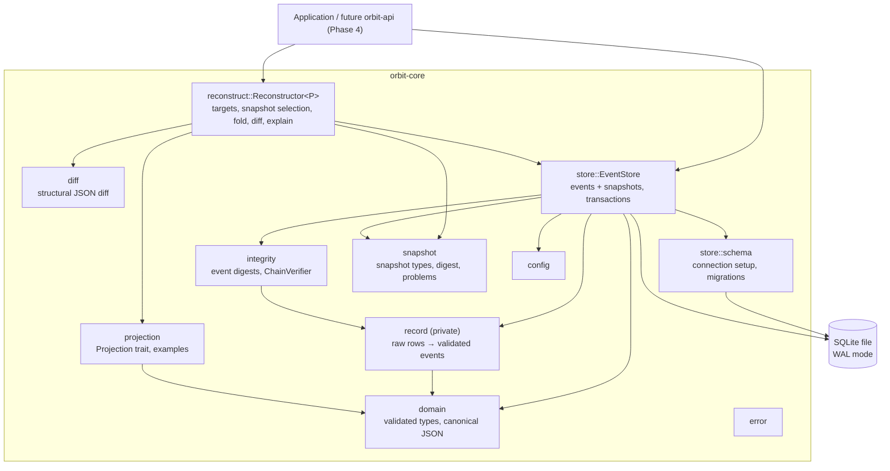
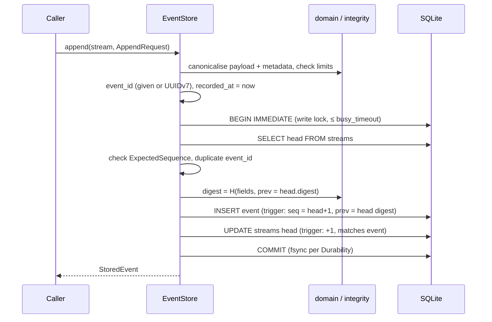
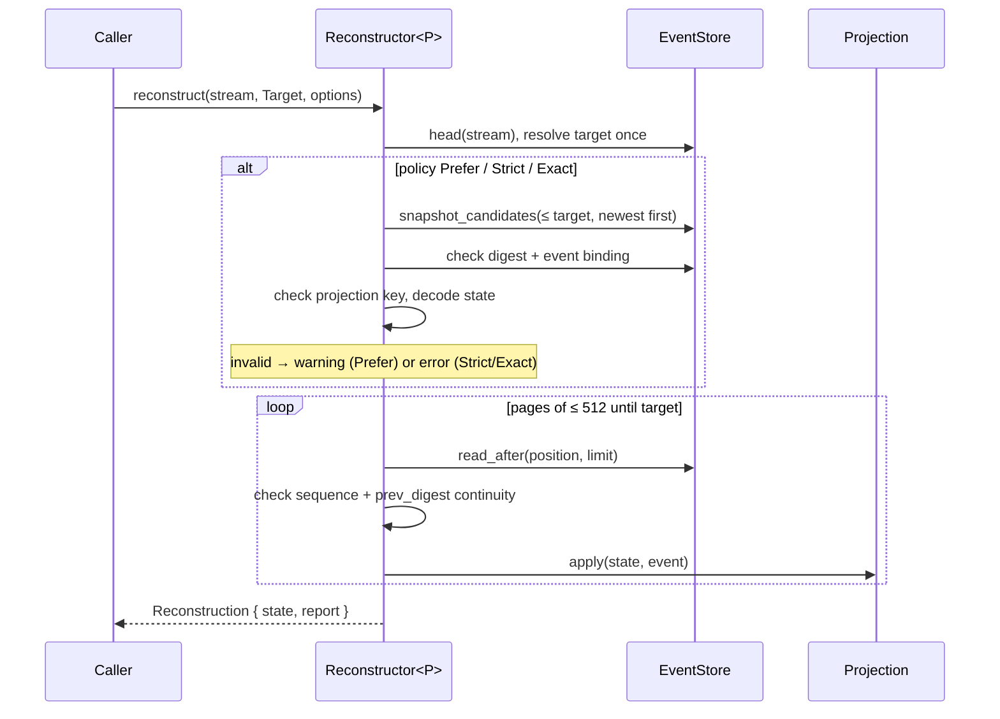
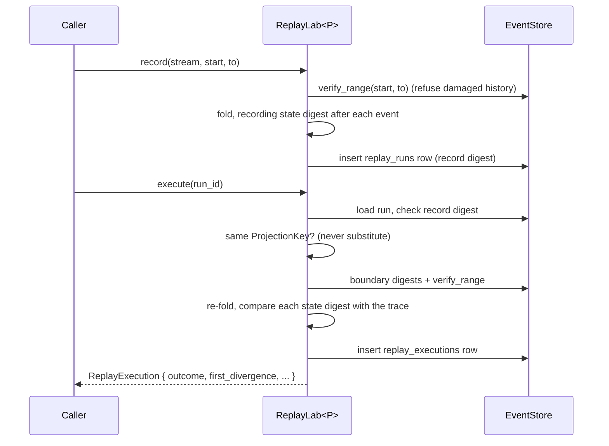

# Architecture

Phases 1–3 deliver one library crate, `orbit-core`, inside a Cargo workspace
(see [ADR 0003](adr/0003-single-crate-concrete-store.md)). Phase 1 is the
event store. Phase 2 adds projections, historical reconstruction, snapshots
and state diffs on top of it. Phase 3 adds fault injection, store-wide
verification with checkpoints, and deterministic replay.

## Components

| Module      | Responsibility | Depends on SQLite? |
|-------------|----------------|--------------------|
| `domain`    | Identifiers, `AppendRequest`, `StoredEvent`, `Stream`, `Timestamp`, `Digest`, canonical JSON. Every value is validated on construction and deserialization. | no |
| `integrity` | `EventDigestInput::compute` (the digest construction), `ChainVerifier`, `IntegrityReport`. | no |
| `record`    | `RawEventRecord`: a row as stored, and its fully validated decoding. Shared by reads and verification. | no |
| `store`     | `EventStore`: transactions, sequence allocation, event and snapshot queries, error mapping. | yes |
| `snapshot`  | `Snapshot`, `SnapshotId`, `ProjectionKey`, the snapshot digest, and `SnapshotProblem` / `SnapshotCheck`. | no |
| `projection`| The `Projection` trait, `ProjectionError`, `decode_payload`, and the `Counter` / `Inventory` examples. | no |
| `reconstruct` | `Reconstructor
`: target resolution, snapshot selection and validation, the bounded fold, equivalence checks, `diff` and `explain`, and reports. | no (uses `EventStore` only) |
| `diff`      | A structural JSON diff with RFC 6901 paths. | no |
| `replay`    | `ReplayLab
`: replay-run records, re-execution against the trace, `ReplayOutcome` classification, experiments. | no (uses `EventStore` only) |
| `fault`     | `FaultPoint`s. With the `fault-injection` feature, a per-store hook (`EventStore::set_fault_hook`). | no |
| `store::verify` | `verify_store`, `checkpoint`, `verify_stream_against`, `list_streams`, and range verification for replay. | yes |
| `store::replay` | Replay-run and execution persistence. | yes |
| `config`    | `StoreConfig`, `Durability`, `Limits`, `ORBIT_*` environment variables. | no |
| `error`     | Typed errors. The driver error is wrapped opaquely (`DatabaseError`). | wraps it |

Only `store` touches `rusqlite`, and no `rusqlite` type appears in the public
API. A future backend would need a new `store` implementation, and nothing else
would change.

## Append data flow

Any error drops the transaction, which rolls it back. The exact semantics are in
[STORAGE_DESIGN.md](STORAGE_DESIGN.md#append-transaction).

## Reconstruction data flow

Reconstruction holds no transaction across the fold. See
[RECONSTRUCTION.md](RECONSTRUCTION.md) and [SNAPSHOTS.md](SNAPSHOTS.md).

## Replay data flow

See [REPLAY.md](REPLAY.md) and [RECOVERY.md](RECOVERY.md).

## Key decisions

| Decision | Record |
|----------|--------|
| SQLite through `rusqlite` with a synchronous API, not `sqlx` | [ADR 0001](adr/0001-sqlite-via-rusqlite.md) |
| Canonical JSON stored and hashed, with a per-stream hash chain | [ADR 0002](adr/0002-canonical-json-and-hash-chain.md) |
| One crate and a concrete store, no storage trait yet | [ADR 0003](adr/0003-single-crate-concrete-store.md) |
| Sequence allocation under `BEGIN IMMEDIATE` | [ADR 0004](adr/0004-sequence-allocation.md) |
| Snapshots bound to an event digest, with no long transactions during reconstruction | [ADR 0005](adr/0005-snapshot-binding-and-boundary.md) |
| Feature-gated fault hooks and child-process crash tests | [ADR 0006](adr/0006-fault-injection-and-crash-testing.md) |
| Self-contained replay runs with a per-event state-digest trace | [ADR 0007](adr/0007-replay-run-records.md) |

Smaller choices:

- **Explicit stream creation.** Appending to an unknown stream is an error,
  not an implicit create. That prevents typos from creating streams.
- **Store-assigned timestamps.** `recorded_at` comes from the store, and only
  `sequence` defines order.
- **Panic-free paths.** Library code avoids `unwrap` and `expect` on anything
  a caller or a damaged file can influence. A poisoned mutex is recovered,
  because rusqlite rolls back open transactions during unwinding.
- **`unsafe_code = "forbid"`** across the workspace.
- **A concrete error type for projections.** `ProjectionError` is a struct
  with a kind and a message, not an associated type. That keeps
  `ReconstructionError` non-generic and serializable.
- **No changes to the Phase 1 API.** Reconstruction is built on the existing
  `read_after`, `event` and `head` methods. Phase 2 only added snapshot
  methods to `EventStore`, plus migration 2.

## Extension points for later phases

- **Phase 4 (API).** Every report is `Serialize`, and requests have
  validating `Deserialize`. This includes reconstruction reports, diffs,
  snapshot statuses, integrity reports, store reports, replay executions and
  experiment reports. Error detail structs and `ErrorClass` map directly to
  HTTP statuses. The Axum layer will call the store through `spawn_blocking`.
- **Phase 5 (hardening).** Benchmarks exist for every subsystem. OS-crash and
  power-loss testing would need a VM-level harness, and is out of scope so far.
