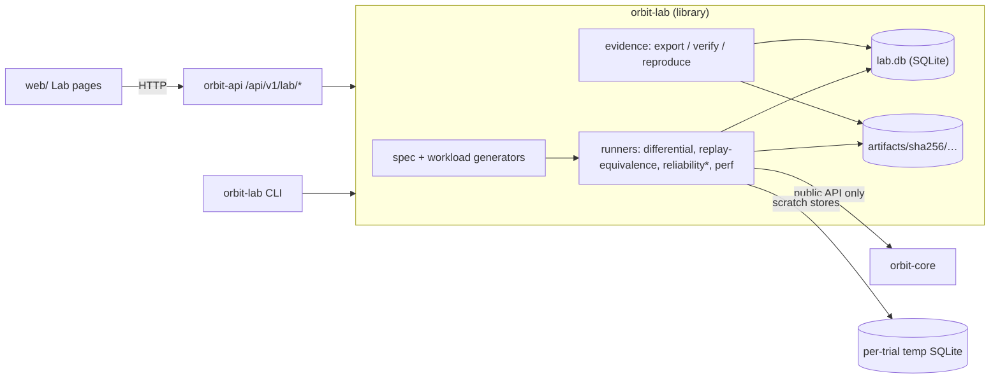
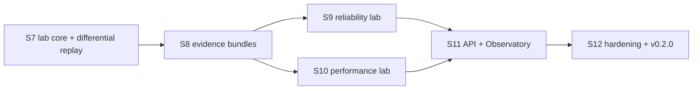

# ATLAS integration: audit and roadmap

This is the Sprint 6 audit and architecture plan for turning ORBIT into an
event-sourcing reliability, replay and performance laboratory. It is a
**plan, not a description of shipped features**: nothing proposed here is
implemented in `v0.1.0`. Each proposal is tied to the code it would reuse
or change.

Audited state: `main` at `7cc2cae`, tag `v0.1.0`, on 2026-10-18.

## 1. Verified repository and release state

| Check | Result | How it was checked |
|-------|--------|--------------------|
| Branch | `main`, tracking `origin/main`, working tree clean | `git status --porcelain=v1 -b` |
| Local and remote `main` | both `7cc2caedca7920bfd336c72c159e5ac7f1c3c857` | `git rev-parse HEAD origin/main`, `git ls-remote origin refs/heads/main` |
| Tag `v0.1.0` | annotated tag object `37820de`, pointing to `7cc2cae`; same on the remote | `git ls-remote origin refs/tags/v0.1.0 'refs/tags/v0.1.0^{}'` |
| GitHub release | `v0.1.0`, pre-release, not a draft, published 2026-10-17T23:01:47Z | `gh release view v0.1.0` |
| Repository | public, default branch `main` | `gh repo view` |
| CI for `7cc2cae` | run 39077208198 succeeded: ubuntu-latest, macos-latest, web, end-to-end | `gh run list`, `gh run view` |
| Backup branch | `backup/pre-coauthor-rewrite` at `fea0e0d`, local only | `git branch -a -vv` |
| Tracked files | 159 | `git ls-files \| wc -l` |

These were re-run during this audit, on rustc 1.99.1 and cargo 1.99.1 (macOS, Apple M3):

| Command | Result |
|---------|--------|
| `cargo fmt --all --check` | clean |
| `cargo clippy --workspace --all-targets --all-features --locked -- -D warnings` | clean |
| `cargo test --workspace --locked` | **204 passed**, 0 failed, 0 ignored |
| `cargo bench --workspace --locked -- --test` | 29 of 29 benchmarks ran successfully (smoke mode, nothing measured) |
| `npm run typecheck`, `npx vitest run` (in `web/`) | types clean; **21 passed** in 4 files |
| `npm run test:e2e` (in `web/`) | **2 passed** (Chromium) |

## 2. Capability inventory

Classes:

- **A:** implemented and verified by tests.
- **B:** implemented but insufficiently tested.
- **C:** partially implemented.
- **D:** not implemented.
- **E:** unknown until further investigation.

Every class rests on the cited code and tests, not on the README.

| Capability | Class | Evidence | Notes |
|------------|-------|----------|-------|
| Append-only event storage | A | `store/mod.rs` (`EventStore::append`, `read_after`). Triggers `events_no_update`, `events_no_delete` and `events_insert_extends_head` in `store/schema.rs`. Tests: `tests/persistence.rs`, `tests/constraints.rs`, `tests/streams.rs`. | Single-event appends only; no batch append. |
| Storage format versioning | A | Schema v3 with migrations in `store/schema.rs` (`migrate`). Tests in `tests/schema.rs` run against the real v1 and v2 fixtures in `tests/fixtures/`. | — |
| Event schema evolution (upcasting) | C | `StoredEvent::schema_version` is stored and hashed (`integrity.rs`, `EventDigestInput`). | No upcasting. Projections must branch on `schema_version` themselves (`ProjectionError::unsupported`). |
| Optimistic concurrency | A | `ExpectedSequence`, `AppendRequest::expect_sequence`. Tests in `tests/concurrency.rs`: `racing_optimistic_writers_exactly_one_wins`, `stale_expected_sequence_is_rejected`. Multi-process test in `tests/stress.rs`: `optimistic_writers_in_separate_processes_never_duplicate_or_lose_events`. | One SQLite writer per file; `StoreError::Busy` is classed as retryable. |
| Digest chain and integrity verification | A | `integrity.rs` (`EventDigestInput::compute`, `ChainVerifier`, `golden_digest`, `length_prefixing_prevents_field_boundary_ambiguity`). `store/verify.rs` (`verify_store`, `checkpoint`, `verify_stream_against`). Tests in `tests/integrity.rs` and `tests/integrity_diagnostics.rs`. | Unkeyed SHA-256 (see SECURITY.md). |
| Snapshots and historical reconstruction | A | `reconstruct.rs` (`Reconstructor::reconstruct`, `create_snapshot`, `compare_with_full_replay`, `diff`, `explain`). `snapshot.rs` (digest binding). Tests: `tests/snapshots.rs`, `tests/reconstruction.rs`, `tests/reconstruction_properties.rs` (proptest, 40 cases), `tests/state_diff.rs`. | Whole state in memory; positional array diffs. |
| Replay traces and divergence classification | A | `replay.rs`: `ReplayLab::record`, `execute`, `evaluate`, and the seven `ReplayOutcome` variants. The trace is one `state_digest` per event. Tests in `tests/replay.rs`, 14 tests including `genuine_divergence_reports_the_first_divergent_event`, `intermediate_divergence_that_reconverges_is_distinguished` and `projection_version_mismatch_is_never_substituted`. Property tests in `tests/replay_properties.rs` (32 cases). | Compares current code with a trace **recorded under the same `ProjectionKey`**. |
| First-divergence diagnosis | C | `DivergencePoint` gives the sequence, event and both digests. | The trace stores **digests only**, so there is no structural diff of the state *at* the divergent event, only of the final state (`ReplayOutcome::Diverged::changes`). Divergence is located, not explained (README limitation). |
| Differential replay (two implementations, one history) | D | `evaluate` returns `Unavailable { ProjectionMismatch }` when keys differ. In tests the only way to compare two implementations is to give the second one the same key (`DriftingCounter::key` returns `Counter.key()` in `tests/replay.rs`). | Implementations sharing a key cannot be told apart. |
| Projection implementation and extensibility | C | `Projection` trait (`projection/mod.rs`); three projections (`Counter`, `Inventory`, `MergePatch`); runtime registry `DynEngine` in `orbit-api/src/engines.rs`. | Compiled in. `ProjectionKey` (id, version) is declared by hand and is not tied to code identity. |
| Fault injection | A | `fault.rs`: 10 `FaultPoint`s and `FaultHook` behind the `fault-injection` feature. `tests/fault_injection.rs`: `hooks_visit_the_documented_points_in_order`, `failed_append_at_any_point_leaves_no_committed_state`, `intermittent_faults_never_corrupt_history`. | Test-only. Not exposed as a parameterised experiment. |
| Crash and recovery testing | A (process crash), D (OS crash, power loss) | `tests/crash_recovery.rs`: child process aborts at fault points, plus `sigkill_during_continuous_appends_preserves_every_acknowledged_event`. | Power loss and OS crash are documented as untested (README, SECURITY.md). |
| Concurrency and recovery *experiments* | C | They exist as fixed tests (`tests/stress.rs` `mixed_workload_preserves_every_invariant`, `tests/concurrency.rs`) and one Criterion group (`benches/crash_lab.rs` `concurrency/*`). | No parameters, no seeds, no recorded results, no invariant-checker API outside the tests. |
| Benchmark infrastructure | B | Criterion suites `benches/event_store.rs`, `benches/reconstruction.rs`, `benches/crash_lab.rs`, 29 benchmarks in all. CI smoke-runs them on Ubuntu. Recorded runs are hand-copied into `docs/DEVELOPMENT.md`. | One run per suite on one laptop. No captured environment, no history, no regression comparison, no per-operation tail latency. Criterion samples are averages over batches of iterations, so p99 latency per operation cannot be derived from them. |
| Benchmark results in API and UI | B | `orbit-api/src/benchmarks.rs` reads Criterion's `target/criterion/**/new/estimates.json`. Unit tests `reads_criterion_layout` and `missing_directory_is_unavailable`. | `measured_at` is the file's modification time. No commit or environment, and results are overwritten by the next run. |
| Experiment persistence and provenance | C | `replay_runs` and `replay_executions` tables with `record_digest` (`store/schema.rs`, `store/replay.rs`). `ReplayLab::experiment` persists one run and one execution. | `ExperimentReport` itself is returned, not stored. No spec, seed, code version, build profile or environment is recorded. |
| Artifact storage | D | None. Results live in SQLite rows or Criterion's `target/` directory. | — |
| Evidence export and independent verification | D | Checkpoints (`StreamCheckpoint`) are the only exportable trust anchor. The UI keeps them in browser local storage. | — |
| API architecture | A | Axum 0.8 router in `orbit-api/src/lib.rs`; `spawn_blocking` in `routes/mod.rs` (`blocking`); OpenAPI from utoipa. Tests: `tests/api.rs` (16), `tests/hardening.rs` (6), `tests/server.rs` (1), plus 7 unit tests. | One shared connection. Reports are typed as `object` in OpenAPI. |
| Frontend observability | B | 8 pages under `web/src/app/` (overview, streams, events, time-travel, snapshots, replay, integrity, benchmarks). Unit tests in `web/tests/unit/`: 21 tests across api, components, format and overview. | Most page views have no component tests. Accessibility was audited by hand in Phase 5; there are no automated a11y tests. |
| End-to-end testing | B | `web/tests/e2e/workflow.spec.ts`: 2 tests (the full workflow, and error display). | One happy path only. |
| CI and reproducibility | A (build and test), C (toolchain pinning) | `.github/workflows/ci.yml`; `Cargo.lock` and `package-lock.json` are honoured (`--locked`, `npm ci`). | Rust is `dtolnay/rust-toolchain@stable`, with no `rust-toolchain.toml` and no MSRV. Node is pinned to major 24 only. |
| Security boundaries | A | SECURITY.md threat table; `orbit-api/tests/hardening.rs`; loopback-only binding in `orbit-api/src/config.rs`. | Local trusted use only. |
| Large-scale behaviour (states near the size limits, near 100k-event replays) | E | `MAX_REPLAY_EVENTS`, `HARD_MAX_BYTES` exist. | Not measured. |
| Windows and other platforms | E | CI covers Ubuntu and macOS only. | — |

### Documentation drift found during the audit

- `docs/ARCHITECTURE.md`, "Extension points for later phases", still
  describes Phase 5 as future work. Updated in this change to point here.

## 3. ATLAS: what could be recovered

I searched:

- this repository at every revision: `git grep -i atlas $(git rev-list --all)` and `git log --all -i --grep=atlas`;
- every other project under `~/Projects` (`*.md`, `*.rs`, `*.ts`, `*.tsx`, `*.toml`, `*.json`, `*.txt`);
- the Claude Code memory directory for this project, which is empty;
- the full transcript of the ORBIT development conversation.

**No prior ATLAS requirements exist in any of these sources.** The other matches were unrelated: texture and sprite atlases in a Unity game project, and Unity skill descriptions. The only description of ATLAS is the Sprint 6 brief itself. Its seven components (Core, Replay Lab, Reliability Lab, Performance Lab, Experiment Registry, Evidence Engine, Observatory) are therefore treated below as **stated direction**, not as recovered history. Nothing in this document claims an earlier ATLAS design.

## 4. ATLAS-to-ORBIT capability mapping

"Exists" means present in ORBIT today; "Proposed" means new work from this plan.

| Brief component | Exists in ORBIT | Proposed | Home | Sprint |
|-----------------|-----------------|----------|------|--------|
| ORBIT Core | Everything in `orbit-core` (A above) | No functional change. At most small, additive public helpers. | `crates/orbit-core` | — |
| Replay Lab: recorded replay and divergence | `ReplayLab`, `ReplayOutcome`, `DivergencePoint` | Keep as is | `orbit-core::replay` | — |
| Replay Lab: differential replay | — | Lockstep two-projection replay, structural diff at the first divergence, self-consistency (determinism) check, prefix reproduction | `orbit-lab::differential` | 7 |
| Replay Lab: projection identity | `ProjectionKey` | `ProjectionDescriptor` = key + build identity + behavioural fingerprint | `orbit-lab::provenance` | 7 |
| Experiment Registry | `replay_runs` / `replay_executions` (replay only) | Spec, run, environment, artifact tables in a separate `lab.db` | `orbit-lab::registry` | 7 |
| Artifact storage | — | Content-addressed files `artifacts/sha256/<2>/<62>` | `orbit-lab::artifacts` | 7 |
| Evidence Engine | Checkpoints; domain-tagged digests | Bundle export, `verify`, `reproduce` | `orbit-lab::evidence` | 8 |
| Reliability Lab | `FaultPoint`, fault and crash tests, stress tests | Seeded fault-matrix and crash experiments with a reusable invariant checker | `orbit-lab::reliability` (feature `reliability`) | 9 |
| Performance Lab | Criterion suites (exploratory) | Workload harness with raw per-operation samples, trial statistics, comparability rules | `orbit-lab::perf` | 10 |
| Observatory | 8 pages; benchmarks page reads Criterion | Lab pages: experiments, run detail, differential viewer, performance comparison, evidence status | `web/`, `orbit-api::routes::lab` | 11 |

## 5. Gaps, priorities and redundancies

Each gap is scored on six criteria:

- **Sig:** technical significance.
- **Reuse:** how much existing architecture it builds on.
- **Feas:** feasibility.
- **Verif:** how well its correctness can be verified.
- **Evid:** potential to produce convincing experimental evidence.
- **Risk:** risk of destabilising existing behaviour.

| # | Gap | Sig | Reuse | Feas | Verif | Evid | Cost | Risk |
|---|-----|-----|-------|------|-------|------|------|------|
| 1 | Differential replay plus projection identity | high | high (`state_digest`, `diff`, `Projection`) | high | **exact** (deterministic digests) | high | M | low (new crate) |
| 2 | Experiment registry, provenance, artifacts | high (everything else needs it) | medium | high | high | medium | M | low |
| 3 | Evidence bundles and independent verification | high | high (`lp` domain-tagged hashing, `EventDigestInput::compute`) | high | exact | high | S–M | low |
| 4 | Reliability experiments (seeded fault matrix, crash) | medium–high | high (`fault.rs`, crash child-process pattern) | medium | exact (invariants) | high | M | medium (feature isolation, below) |
| 5 | Statistical performance lab | high | low–medium (Criterion stays separate) | medium | statistical only | high, *if* done carefully | L | low |
| 6 | Observatory lab views | medium | high (existing pages and API client) | high | medium (UI tests) | medium (presentation) | M–L | low |
| 7 | Toolchain pinning (`rust-toolchain.toml`) | medium (reproducibility) | — | trivial | exact | low | XS | low |

**Do not rebuild these (redundant or premature):**

- **The storage engine, hash scheme or canonical JSON.** Reuse
  `to_canonical_string`, `state_digest` and the `lp` length-prefixed,
  domain-tagged SHA-256 construction. A second hash format would split the
  evidence model.
- **The JSON diff.** `diff::diff` is tested and serializable. LCS array
  alignment is a separate, optional improvement, not a prerequisite.
- **`ReplayLab`.** Differential replay is a sibling, not a replacement.
  `ReplayLab::experiment` stays as the "replay equivalence" experiment kind
  and is wrapped, not rewritten.
- **Criterion.** Keep it for micro-benchmarks and CI smoke tests. Do not
  re-implement its estimators. The new harness covers what Criterion
  structurally cannot: per-operation distributions, independent trials, and
  provenance.
- **Infrastructure.** No job queue, worker service, message broker, hosted
  database or remote runner. Experiments run in-process or in child
  processes that the CLI spawns, the pattern `tests/crash_recovery.rs`
  already uses. Nothing so far justifies distributed infrastructure.
- **Plugin loading or WASM projections.** A compiled-in registry with
  recorded build identity is enough for differential replay. Dynamic
  loading would add a sandboxing problem without new evidence.
- **The fault hooks.** Reuse `FaultPoint::ALL` and `set_fault_hook`; do not add
  a parallel fault mechanism.

## 6. Experiment architecture

### Placement

The plan adds a single new crate, **`crates/orbit-lab`**, with a library and a
CLI binary. It depends on `orbit-core` and is used by `orbit-api`. A separate
crate rather than modules inside `orbit-core`, for three reasons:

- `orbit-core` stays the **system under test**, with its current dependency
  set and correctness surface. `rand`, statistics code and any file-artifact
  handling do not enter it.
- Release-quality measurements and crash experiments should not run inside
  the HTTP server. A CLI can run headless, in CI, and as a child process.
- It needs **no change to the store schema** (stays v3). Lab data lives in
  its own database.



`*`: compiled only with the `reliability` feature (see Sprint 9).

**The registry is separate from the event store.** Experiments create
disposable scratch stores, inject faults into them and kill processes
writing them. The registry must never be the system under test, so it is a
separate SQLite file (`lab.db`, default `./data/lab/`). Analysing an existing
store opens it read-only for history and writes nothing to it.

### Experiment specification

The spec is JSON. Its identity is the `state_digest`-style digest of its
canonical form, under a new domain tag `ORBIT-LAB-SPEC-V1`.

```json
{
  "spec_version": 1,
  "kind": "differential_replay",
  "name": "inventory v1 vs v2 on generated orders",
  "workload": {
    "source": "generated",
    "generator": "inventory",
    "generator_version": 1,
    "events": 5000,
    "seed": 1234567
  },
  "params": {
    "left": "inventory@1",
    "right": "inventory-candidate@1",
    "ignore_paths": [],
    "stop_at_first_divergence": false
  }
}
```

- **`kind`.** One of `differential_replay`, `replay_equivalence`,
  `fault_matrix`, `crash_recovery`, `concurrency` or `performance`. Each kind
  has its own typed `params`. Unknown kinds or fields are rejected
  (`deny_unknown_fields`).
- **`workload.source`.**
  - `generated`: a generator name and version, plus a **required `seed`**.
    Generators use a seeded PRNG implemented in-crate (SplitMix64 or
    Xoshiro256**, about 20 lines), so the sequence cannot change with a
    dependency upgrade.
  - `store_interval`: an existing stream, pinned like a replay run by
    `(stream, from, to, from_event_digest, to_event_digest)`.
  - `history_artifact`: a digest of an exported history (§6, artifacts).
- **`generator_version`** is bumped whenever a generator's output for a given
  seed changes. A golden test pins the digest of the first N events per
  generator, so an accidental change fails CI.

### Execution and results

```text
spec ─▶ validate ─▶ materialise workload ─▶ run (trials) ─▶ outcome + artifacts ─▶ registry
                    (scratch store or        (kind-specific)
                     read-only interval)
```

Registry tables in `lab.db`. Each is append-only, with triggers in the same
style as `store/schema.rs`.

| Table | Columns |
|-------|---------|
| `experiments` | `id` (UUIDv7), `spec` (canonical JSON), `spec_digest`, `created_at` |
| `runs` | `id`, `experiment_id`, `status`, `started_at`, `finished_at`, `environment_digest`, `outcome_label`, `result` (canonical JSON summary), `run_digest` |
| `run_events` | `run_id`, `seq`, `at`, `status` (status transitions; rows are never updated) |
| `artifacts` | `digest` (PK), `media_type`, `bytes`, `created_at` |
| `run_artifacts` | `run_id`, `role` (`history`, `trace_left`, `samples`, `environment`, `report`…), `digest` |

`status` takes one of `running`, `completed`, `failed`, `abandoned` or
`invalid`. A `running` run with no terminal status when `lab.db` is opened
is marked `abandoned`. It is never silently treated as completed. Tests
cover this with the fault-hook pattern from `tests/fault_injection.rs`.

### Reproducibility metadata (`Environment`)

The environment is captured once per run and stored as an artifact, so
results can be compared by digest.

| Field | Source | Why |
|-------|--------|-----|
| `orbit_version` | `CARGO_PKG_VERSION` | — |
| `git_commit`, `git_dirty` | `build.rs` runs `git rev-parse HEAD` and `git status --porcelain`; `"unknown"` if git is unavailable | Ties results to code |
| `rustc`, `target`, `profile` | `build.rs` (`RUSTC -V`, `TARGET`, `PROFILE`) | Debug builds are never release-quality |
| `features` | `cfg!(feature = …)` | Fault hooks change timing |
| `sqlite_version` | `rusqlite::version()` | — |
| `os`, `os_version`, `cpu_model`, `logical_cpus`, `memory_bytes` | `uname` / `sysctl` on macOS, `/proc` on Linux | Comparability |
| `power_source` | `pmset -g batt` on macOS, if available | Laptops throttle on battery |
| `durability`, `busy_timeout` | `StoreConfig` | Changes write cost by orders of magnitude (`append/full` vs `append/normal` in DEVELOPMENT.md) |
| `projections` | `ProjectionDescriptor` list | Code identity |

No hostname, user name or absolute path is recorded, matching the API's
"no local paths" rule (`tests/hardening.rs`, `errors_never_contain_local_paths`).

### Artifacts and content hashes

- Each artifact is stored as a file `artifacts/sha256/ab/cdef…`, written to a
  temporary file, fsynced and renamed. Its digest is SHA-256 of the bytes
  (no domain tag, so standard `shasum -a 256` verifies it).
- **History artifact.** JSON Lines, one `StoredEvent` per line, including
  `recorded_at`, `prev_digest` and `digest`. A verifier recomputes the chain
  with the public `EventDigestInput::compute` without opening any store.
- **Trace artifact.** Concatenated 32-byte state digests, the same layout as
  `replay_runs.trace`.
- **Samples artifact.** Little-endian `u64` nanoseconds, one per operation,
  with its count stated in the run result.

### Comparison and statistics

Comparison is defined per kind:

- **Deterministic kinds** (`differential_replay`, `replay_equivalence`,
  `fault_matrix`, `crash_recovery` outcomes): two runs agree when their
  outcome labels and trace or result digests are identical. Agreement is
  checked by equality, not by statistics.
- **Performance:** see §8.

### Evidence export and verification

See Sprint 8 (§9). A bundle is a directory containing `manifest.json` and the
artifacts it lists. The manifest digest uses domain tag `ORBIT-EVIDENCE-V1`.

### Stable interfaces

| Boundary | Interface | Stability rule |
|----------|-----------|----------------|
| core → lab | `orbit-core`'s **public** API only: `EventStore`, `Projection`, `StoredEvent`, `state_digest`, `diff::diff`, `to_canonical_string`, `EventDigestInput`, `ReplayLab`, `Reconstructor`, and `FaultPoint` / `set_fault_hook` under the feature | No `pub(crate)` widening. Sprint 7 needs **no** core change: differential replay folds `read_after` pages through `Projection::apply` directly. |
| lab → runners | `trait Runner { fn kind(&self) -> Kind; fn run(&self, spec: &Spec, ctx: &mut RunContext) -> Result<RunResult, LabError>; }` | One implementation per kind, with no plugin system |
| projection registry | `trait DynStepper { fn descriptor(&self) -> ProjectionDescriptor; fn initial(&mut self) -> Result<Value, LabError>; fn step(&mut self, event: &StoredEvent) -> Result<Value, StepError>; }`, with a blanket adapter for any `P: Projection` | Replaces nothing in `orbit-api/src/engines.rs`. `DynEngine` gains a `stepper()` constructor. |
| lab → API | `Registry::{experiments, runs, run, artifact}`, plus `run_deterministic(spec)` for `differential_replay` and `replay_equivalence` only | The API never launches performance or reliability runs (§8, §9) |
| API → UI | `/api/v1/lab/*` JSON, documented in OpenAPI; artifacts served with a size cap and an allowlist of media types | Same Host, CORS and deadline guard as today |

### Minimum first implementation and later work

- **Minimum (Sprint 7):**
  - the `orbit-lab` crate;
  - spec, registry, artifacts and environment;
  - one generator (counter);
  - the `differential_replay` runner;
  - CLI `orbit-lab run <spec.json>` and `orbit-lab show <run>`.
- **Later:** evidence bundles (8), reliability (9), performance (10), API and
  UI (11).

## 7. Differential replay design

**Goal.** Run two projection implementations, **left** and **right**, over
an identical event history. Report whether they agree, and if not, where
they first diverge, how the two states differ at that event, and whether
they reconverge. Then make the result reproducible.

### What already exists and is reused

| Need | Existing code |
|------|---------------|
| Pinned, verified input interval | The boundary-digest scheme of `replay_runs` and `EventStore::verify_stream` / `verify_stream_against` (public). Verification runs before folding, as `ReplayLab::record` does. |
| Canonical state comparison | `state_digest` (`ORBIT-STATE-DIGEST-V1`) over `to_canonical_string` |
| Structural differences | `diff::diff` → `Vec<Change>` (JSON Pointer paths, sorted keys) |
| Divergence vocabulary | `DivergencePoint` fields; `ReplayOutcome` labels such as `reconverged` and `diverged` |
| A known diverging implementation for tests | `DriftingCounter` in `tests/replay.rs`; a lab test fixture copies the pattern |
| Cross-check oracle | `ReplayLab::record` trace for the same projection and interval |

### What genuinely has to be added

1. **`ProjectionDescriptor`.** This is `{ key, implementation, build }`:
   - `implementation` is a registry name (for example `inventory-candidate`);
   - `build` is `{ orbit_version, git_commit, git_dirty }`.

   A **behavioural fingerprint** is also computed: the final `state_digest`
   and trace digest over a fixed, seeded probe workload. Two
   implementations with the same `ProjectionKey` but different fingerprints
   are reported as *"same key, different behaviour"*. This is exactly the
   case `ReplayLab` cannot detect today (`DriftingCounter` reuses
   `Counter`'s key).
2. **The lockstep runner.** For each event `e_k`:
   1. Apply left, then right. Each step runs inside
      `std::panic::catch_unwind`, so a panic becomes a reported outcome
      rather than a crash. This is safe Rust and compatible with
      `unsafe_code = "forbid"`.
   2. Encode both states with `serde_json::to_value`, then compute their
      `state_digest`.
   3. If the digests differ and this is the first divergence, record:
      - `k`, the event id, type and schema version;
      - both digests;
      - the number of matched events before `k`;
      - **`diff(left_state, right_state)` at `k`**, which the current replay
        cannot produce, because it keeps only digests;
      - the last agreeing digest, at `k-1`.
   4. Append each side's digest to its trace.

   Memory use is two states plus two 32-byte traces, so the existing
   100,000-event cap is not a memory problem. Whether to keep the same cap
   is still an open question (§11).
3. **The outcome type:**

   | Outcome | Meaning |
   |---------|---------|
   | `equivalent` | Every intermediate and final state digest is equal |
   | `reconverged { first }` | They differed at some point but end equal |
   | `diverged { first, final_changes }` | The final states differ |
   | `left_failed` / `right_failed { failure, first? }` | One side returned a `ProjectionError` |
   | `both_failed { left, right, same_event, same_kind }` | Both failed. Agreeing on a rejection is reported, not hidden. |
   | `panicked { side, at, message }` | — |
   | `nondeterministic { side, at }` | Self-consistency failed (see below) |
   | `integrity_failure` | The input history failed verification. Nothing is folded. |
   | `invalid_input` | — |

4. **Determinism requirements and checks.**
   - The `Projection` contract already forbids clocks, randomness, I/O and
     global state (`projection/mod.rs`).
   - Rust code cannot be sandboxed, so the runner **checks**: each side is
     run twice on fresh instances, and both traces must be identical. A
     mismatch is `nondeterministic` and suppresses the left/right verdict,
     because comparing a nondeterministic side would be meaningless.
   - This catches per-instance randomness, such as logic that depends on
     `HashMap` iteration order, which is seeded per map. It also catches
     global counters. It **cannot** prove determinism; it can only
     disprove it. The report must say so.
   - Serialized state ordering is already canonical: keys are sorted, so
     `HashMap` *serialization* order is not a source of false divergence.
   - Floats use serde_json's shortest round-trip form. `-0.0` and `0.0`
     encode differently and are reported as a divergence. NaN cannot be
     encoded, so it becomes a failed step. Both are documented.
5. **External dependencies.** A projection that needs outside data (rates,
   configuration) is out of contract. The supported route is to record that
   data as events. The runner has no mechanism for injecting live
   dependencies, by design.
6. **Intentional shape differences.** A v2 projection may add fields.
   `ignore_paths` (JSON Pointers) removes those paths from both states
   before digesting. Ignored paths are part of the spec digest and are
   listed in every report, so an exclusion is never invisible.
7. **Reproduction.**
   - The run stores the spec, both descriptors, both traces, the outcome,
     and for non-generated workloads the history artifact.
   - It also stores the **prefix artifact** `e_1..e_k` up to the first
     divergence. A prefix of a valid history is always a valid history, so
     it is a correct minimal *prefix* reproduction. Shrinking further, as
     delta debugging does, is not always valid, because removing events
     changes meaning; it is deferred.
   - `orbit-lab reproduce <run>` rebuilds the workload from the seed or the
     artifact, reruns both sides, and requires identical traces and outcome.
8. **Persistence.** Runs go to `lab.db`, not to the store's `replay_runs`
   table. The store schema stays at v3.

### Regression tests (acceptance for Sprint 7)

- `Counter` vs `Counter` → `equivalent`.
- Cross-check: the left trace equals `ReplayLab::record(…).trace` for the same
  interval, byte for byte. This is a property test over generated workloads.
- `Counter` vs a drifting counter from sequence 4 → `diverged`, with the
  first divergence at 4, `matched_events == 3`, and an at-event diff
  `[/value]`.
- A pair that differs mid-stream and agrees at the end → `reconverged`.
- One side rejects an event → `right_failed`, with the event id.
- Both reject the same event → `both_failed`, with `same_event == true`.
- A projection that panics on one event type → `panicked`, and the process
  survives.
- A projection using a global `AtomicU64` → `nondeterministic`.
- `ignore_paths` hides only the listed paths, and appears in the report.
- A tampered history artifact → `integrity_failure`, with no fold.
- Golden tests:
  - the generator digest for seed 1;
  - the spec digest;
  - re-running a stored run reproduces identical traces.
- An abandoned-run recovery test, with a fault before the terminal status.

## 8. Statistical performance lab design

### Two tiers, kept apart

| Tier | Tool | Use | Claims allowed |
|------|------|-----|----------------|
| Micro (exploratory) | Existing Criterion suites | Developer feedback, CI smoke | "Indicative, single machine, single run" (as now) |
| Workload (lab) | New `perf` runner | Release notes, regression decisions | Only what the comparability and sample rules below permit |

The lab harness exists because Criterion measures **batched iterations**. It
reports a mean or median *per iteration of a sample*, not a distribution of
individual operations. Tail latency (p99) of appends or reconstructions
therefore needs per-operation timings.

### Workloads

All workloads are seeded and digest-pinned:

| Workload | Parameters | Measures |
|----------|------------|----------|
| `append` | durability `normal` / `full`, payload size {≈150 B, 1 KiB, 16 KiB, 256 KiB}, events per trial | per-append latency |
| `append_concurrent` | writers {1, 2, 4, 8}, one `EventStore` (connection) per thread, optimistic or unconditional | throughput, latency, `Busy` and `SequenceConflict` rates |
| `reconstruct` | stream length {1k, 10k, 100k}, target, snapshot policy, snapshot positions | per-reconstruction latency |
| `snapshot_vs_full` | the same database and target; full replay vs snapshot at `k` | paired comparison |
| `verify` | stream length, store with snapshots | verify latency |
| `replay_execute` | interval length, start source | execute latency |

### Protocol

1. **Setup.** Build the dataset in a fresh temporary directory, outside the
   timing, as the current benches do. Record its digest.
2. **Warm-up.** A fixed operation count (default: 10% of the measured
   count, at least 100), discarded but counted in the report. Using a fixed
   count rather than a time makes trials comparable across machines.
3. **Trials.** `R` independent trials (default 10, minimum 5). Each trial
   uses a fresh scratch store. With `--isolate` it runs in a fresh child
   process, so allocator, page-cache and WAL state do not carry over.
4. **Interleaving.** When comparing variants A and B (snapshot vs full,
   durability, writer count), trials are interleaved in a seeded random
   order (for example ABBA BAAB), so thermal and background drift affects
   both sides equally.
5. **Samples.** Each operation is timed with `Instant` and stored raw, in
   nanoseconds, in the samples artifact. Analysis is always recomputable
   from the raw data.

### Statistics

- **Per trial:**
  - n, median, p90, p99, p99.9, min, max, mean, MAD;
  - throughput (operations divided by wall time).
- **Percentile reporting rule.** A percentile `p` is reported only when
  `n ≥ 10 / (1 − p)`: p99 needs n ≥ 1,000, and p99.9 needs n ≥ 10,000.
  Otherwise the report shows "insufficient samples", never a number.
- **Across trials.** The **trial is the unit of independence.** Operations
  within a trial are autocorrelated (cache state, WAL growth,
  checkpoints), so pooling them as independent observations would
  overstate confidence.
  - The headline figure is the median of trial medians (likewise for p99).
- **Confidence intervals.**
  - Seeded percentile bootstrap over the trial-level statistic, with
    B = 10,000 resamples. The seed is stored, so a verifier re-derives the
    identical interval.
  - Shown only when R ≥ 10. With 5 ≤ R < 10, the spread (min–max of
    trial medians) is shown instead and labelled.
- **Regression comparison** (baseline vs candidate). This computes the ratio
  of medians of trial medians, with a bootstrap CI for the ratio. The
  verdict is:
  - `regression` / `improvement` only if the CI excludes 1 **and** the
    change exceeds a practical threshold (default 5%);
  - `no detectable change` otherwise.

  The threshold is calibrated by an **A/A run**, the same build twice; a
  release-quality comparison requires a recorded A/A result for that
  environment.

### Protection against misleading comparisons

The lab **refuses** to compare two runs unless all of the following match:

- the workload digest;
- the `profile` (release);
- the durability setting;
- the `cpu_model`, `os` and `sqlite_version`;
- the feature set (no `fault-injection`).

Exploratory runs may override a mismatch with `--allow-cross-environment`,
and the result is then labelled as not comparable. Debug builds are always
labelled `debug, not representative`. Units, n and R appear next to every
number.

### Exploratory vs release-quality

A run is **release-quality** only when all of these hold:

- `profile = release`;
- `git_dirty = false`;
- R ≥ 10;
- warm-up recorded;
- a recorded A/A calibration for that environment;
- no other lab run holding the lab lock;
- on macOS, `power_source = AC` where it can be determined.

Everything else is **exploratory**. Only release-quality results may be
quoted in the README or release notes, always with their environment and
run id. GitHub-hosted runners are shared and noisy, so CI performance runs
stay exploratory: smoke-checked for regressions in *behaviour*, never
cited as measurements.

No measurements are reported in this document. None have been made with this
harness, because it does not exist yet.

## 9. Roadmap (Sprint 7 onward)

Effort is in focused working days for one developer. These are estimates, not commitments.



### Sprint 7: Lab foundation and differential replay

- **Objective:** a reproducible differential-replay experiment, end to end,
  from the CLI.
- **Deliverables:**
  - the `crates/orbit-lab` crate (library and `orbit-lab` binary);
  - `Spec` with validation and digest; a seeded PRNG; the `counter` and
    `inventory` generators with golden digests;
  - the `Environment` capture and a `build.rs`;
  - the `lab.db` registry with append-only triggers and abandoned-run
    recovery;
  - the content-addressed artifact store;
  - `DynStepper` and `ProjectionDescriptor` with a behavioural fingerprint;
  - the `differential_replay` runner;
  - CLI commands `run`, `show`, `list`;
  - `rust-toolchain.toml` pinning the toolchain CI uses;
  - docs (`docs/LAB.md`, ADR 0009 for the lab crate and the separate
    registry).
- **Reuse:**
  - `state_digest`, `to_canonical_string`, `diff::diff` and `Projection`;
  - `EventStore::read_after` and `verify_stream`;
  - `ReplayLab` as the test oracle;
  - the test helpers' patterns (`TestDb`).
- **Likely to change:**
  - new crate; workspace `Cargo.toml`;
  - `orbit-api/src/engines.rs` (a `stepper()` constructor only, no route
    changes);
  - CI (lab tests, plus the feature-isolation check described in Sprint 9).
- **Tests and acceptance:**
  - all §7 regression tests;
  - the existing 204 Rust, 21 web and 2 end-to-end tests unchanged and
    passing;
  - no edits under `crates/orbit-core/src` (`git diff --stat` shows none);
  - clean-clone run of `orbit-lab run examples/lab/counter-drift.json`
    produces a `diverged` result at the documented event.
- **Risks:**
  - over-designing the spec; mitigated by supporting only the
    `differential_replay` kind;
  - `build.rs` git capture failing in tarball builds; it falls back to
    `unknown`.
- **Effort:** 7–10 days.
- **Depends on:** nothing new.

### Sprint 8: Evidence engine

- **Objective:** anyone with the bundle and the ORBIT source can check
  integrity, re-derive results and re-execute deterministic runs.
- **Deliverables:**
  - `orbit-lab export <run> <dir>`: `manifest.json` (spec, environment,
    descriptors, outcome, artifact list with roles and SHA-256, manifest
    digest `ORBIT-EVIDENCE-V1`) plus the artifacts;
  - `orbit-lab verify <dir>`, with verification levels:
    - **L0:** every hash and the manifest digest;
    - **L1:** the history chain recomputed with `EventDigestInput::compute`,
      and trace and outcome consistent;
  - `orbit-lab reproduce <dir>`:
    - **L2:** re-execution with an identical outcome and traces;
  - a history export from a store interval;
  - the prefix reproduction artifact.
- **Reuse:**
  - the `lp` hashing pattern, `EventDigestInput`, `StreamCheckpoint`;
  - the registry and artifacts from Sprint 7.
- **Tests:**
  - tampering any byte of any artifact, or of the manifest, fails L0 with
    the right file named;
  - a reordered history fails L1;
  - a reproduced run is identical;
  - a bundle from one temp directory verifies from another, with no
    absolute paths.
- **Limitations stated in the docs:** hashes are unkeyed, so a bundle proves
  internal consistency, not authorship. Optional signing with the user's own
  free tool (`ssh-keygen -Y sign`) is documented, not built in.
- **Effort:** 4–6 days.
- **Depends on:** Sprint 7.

### Sprint 9: Reliability lab

- **Objective:** seeded, recorded fault and crash experiments with a
  reusable invariant checker.
- **Deliverables:**
  - the `fault_matrix` kind: workload × `FaultPoint` × visit index (seeded),
    with a fault injected once, retried, and the invariants checked;
  - the `crash_recovery` kind: the CLI re-executes itself as a child
    process, aborts or SIGKILLs it at a seeded point, reopens the store and
    checks invariants against the child's acknowledgement log;
  - a `concurrency` kind: N writers, optimistic or not, with recorded
    conflict and busy counts;
  - `Invariants::check(store, &AckLedger)`:
    - dense sequences;
    - `verify_store` valid;
    - every acknowledged event present with an identical digest;
    - no unacknowledged effects of failed operations.
- **Reuse:** `fault.rs`, and the patterns in `tests/fault_injection.rs`,
  `tests/crash_recovery.rs` and `tests/stress.rs`. The existing tests stay
  as they are; they are not moved.
- **Key design constraint: feature isolation.**
  - Cargo unifies features. If `orbit-api` depended on a lab crate that
    enabled `orbit-core/fault-injection`, the **API binary would contain
    fault hooks**.
  - Reliability runners therefore sit behind an `orbit-lab` feature,
    `reliability`, that `orbit-api` never enables.
  - CI asserts that `cargo tree -p orbit-api -e features` does not contain
    `fault-injection`.
  - The API only *displays* reliability runs from the registry.
- **Tests:**
  - every `FaultPoint` covered;
  - the same seed gives the same fault schedule and outcome;
  - a deliberately broken invariant (a test-only store wrapper that hides
    an acknowledged event) is detected;
  - the feature-isolation CI check.
- **Not covered:** OS crash and power loss, which still need a VM-level
  harness. That remains documented as untested.
- **Effort:** 6–9 days.
- **Depends on:** Sprints 7 and 8.

### Sprint 10: Performance lab

- **Objective:** defensible workload measurements and regression
  comparisons (§8).
- **Deliverables:**
  - the `performance` kind, with the §8 workloads;
  - warm-up, trials, `--isolate`, interleaving;
  - the raw samples artifact;
  - the statistics module (percentiles, MAD, seeded bootstrap);
  - `orbit-lab compare <baseline> <candidate>` with comparability refusal;
  - the A/A calibration command;
  - exploratory and release-quality labelling;
  - a lab lock file.
- **Reuse:**
  - dataset builders from `benches/*.rs`, ported into generators;
  - the Criterion suites unchanged;
  - the Sprint 7 environment capture.
- **Tests:**
  - statistics checked against hand-computed fixtures, including
    percentile edge cases and the n threshold;
  - bootstrap determinism under a fixed seed;
  - comparability refusal for each mismatched field;
  - a synthetic samples artifact with a known 20% shift detected as a
    regression, and a 1% shift as no detectable change;
  - debug-build labelling.
- **Risks:**
  - laptop noise;
  - small R limits the width of CIs. The lab reports wide intervals
    honestly rather than shrinking them.
- **Effort:** 8–12 days.
- **Depends on:** Sprints 7 and 8. It can run in parallel with Sprint 9.

### Sprint 11: API and Observatory integration

- **Objective:** one coherent interface over experiments.
- **Deliverables:**
  - endpoints:
    - `GET /api/v1/lab/experiments`, `/runs`, `/runs/{id}`,
      `/artifacts/{digest}` (size cap, media-type allowlist),
      `/compare?baseline=&candidate=`;
    - `POST /api/v1/lab/runs` for deterministic kinds only, under the
      existing deadline and Host guard;
  - pages:
    - Experiments;
    - Run detail;
    - a differential viewer: aligned traces, first divergence, at-event
      diff using the existing diff components;
    - a performance comparison with labels and n/R always visible;
    - evidence verification status;
  - the existing Benchmarks page relabelled "Criterion (exploratory)".
- **Reuse:**
  - the `routes/` patterns and `blocking`;
  - the hardening tests;
  - the web `useApi` and `useAction` hooks and the UI components.
- **Tests:**
  - API tests in the style of `tests/api.rs`, including the Host guard
    and size caps on the new routes;
  - Vitest component tests for every new view;
  - an end-to-end flow: run a differential experiment, inspect the
    divergence, export and verify.
- **Effort:** 8–10 days.
- **Depends on:** Sprints 9 and 10. It can start on Sprints 7–8 data.

### Sprint 12: Hardening and `v0.2.0`

- **Objective:** a verified release of the lab.
- **Deliverables:**
  - a clean-clone verification;
  - one documented **release-quality** performance run, with its run id and
    environment;
  - an exported evidence bundle for the differential example, verified from
    a clean clone;
  - documentation and changelog;
  - a decision on `#[non_exhaustive]` for the lab outcome enums.
- **Effort:** 3–5 days.
- **Depends on:** all previous sprints.

## 10. Recommended first milestone

**Sprint 7: differential replay on a minimal lab foundation.** The reasons:

- **It extends the strongest existing capability** (A-class replay and
  digests) instead of starting a new area. It needs no change to the core or
  its schema.
- **Its correctness is checkable exactly.** Outcomes are digests, and there
  is an independent oracle, `ReplayLab::record`'s trace. A result is right or
  wrong, with no statistical judgement.
- **It closes a real, demonstrated gap.** Today two implementations sharing a
  `ProjectionKey` cannot be distinguished (`DriftingCounter` in
  `tests/replay.rs`), and the state at the divergent event cannot be diffed.
- **It forces the registry, artifacts and provenance to exist with a real
  consumer**, before the noisier performance work depends on them, avoiding
  speculative abstraction.

Definition of done: the §7 tests and the Sprint 7 acceptance items above,
CI green, and a clean clone reproducing the example result.

## 11. Risks, open questions and limits of this audit

**Risks**

- Feature unification leaking fault hooks into the API binary. This is
  mitigated by design and a CI check (Sprint 9).
- Scope growth across six experiment kinds. Mitigation: kinds land one per
  sprint, and each kind lands only with its regression tests.
- A behavioural fingerprint is only as good as its probe workload. It can
  show two builds behave differently; it cannot show they behave the same.
- Laptop-only release-quality measurements limit generality. Every number
  will carry its environment.

**Open questions for the maintainer**

1. Is a separate `lab.db` acceptable, or should lab tables live in the event
   store (which would mean a schema v4 migration)? Recommended: separate.
2. Should differential replay keep the 100,000-event cap, given its memory
   use is bounded?
3. Should `ignore_paths` be enough for v1-to-v2 comparisons, or are explicit
   state-mapping functions needed? Recommended: start with `ignore_paths`
   and add mappings only when a real case needs them.
4. The MSRV and toolchain policy that `rust-toolchain.toml` should pin.
5. Whether evidence signing should ever be built in, or stay with external
   free tools.

**Verification limits of this audit**

- Capability classes come from reading the code and tests listed, and from
  re-running the test suites on one macOS machine. No new tests were
  written, and no coverage tool was run.
- The frontend's accessibility state is carried over from the Phase 5 manual
  audit; it was not re-audited here.
- Windows, OS-crash and power-loss behaviour are not known (class E or D).
- The ATLAS search covered the sources listed in §3. Material outside this
  machine and repository, such as other accounts, chats or paper notes,
  could not be searched.
