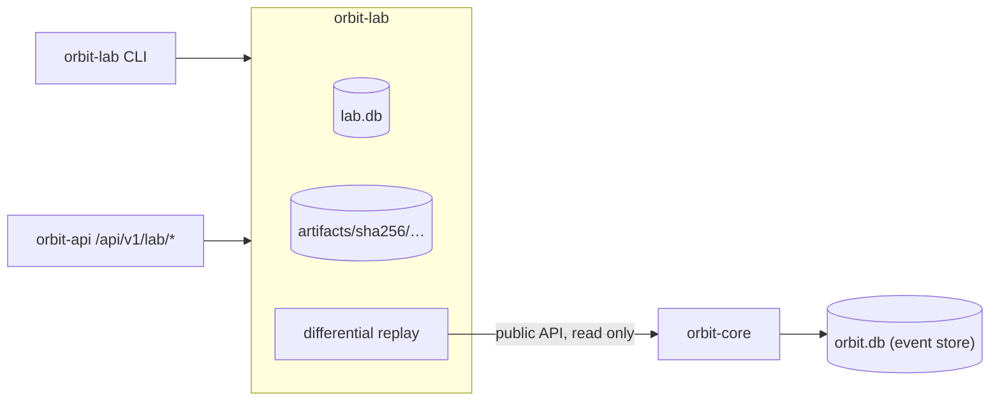

# The ORBIT lab: experiment registry and differential replay

`crates/orbit-lab` adds the first part of the lab planned in
[ATLAS_INTEGRATION.md](ATLAS_INTEGRATION.md):

- an **experiment registry** in its own SQLite database;
- a content-addressed **artifact store**;
- **implementation identities** that tell apart two projection
  implementations sharing a name and version;
- **differential replay**: two implementations over one ordered history,
  with first-divergence diagnosis.

It is exposed through a library, an `orbit-lab` CLI, five API endpoints and
the Observatory's **Experiments** page.

Nothing here is a statistical or scientific claim. A differential replay
reports exactly what two pieces of code computed over one history.

## Boundary with `orbit-core`



- **One-way dependency.** `orbit-lab` depends on `orbit-core` and uses only
  its public API:
  - `EventStore::head`, `read_after`, `event` and `verify_stream`;
  - the `Projection` trait;
  - `state_digest`, `diff::diff` and `to_canonical_string`.

  `orbit-core` knows nothing about the lab. Its code, event format and schema
  (v3) are unchanged.
- **Read only.** The lab never writes to an event store. The CLI refuses to
  create a missing store.
- **Separate database.** Experiments live in `lab.db`, never in the event
  store. The two files have different `PRAGMA application_id`s:
  - the store is `ORBT`;
  - the lab is `ORLB`.

  Neither can be opened as the other; tests cover both directions.
- **No duplicated engine.** The lab doesn't reimplement storage, integrity
  checking, digests or diffs; it calls the core for them. It does not replace
  `ReplayLab` either. That compares current code with a trace recorded under
  the same `ProjectionKey`, while the lab compares two live implementations.

## Directory layout

```text
<lab dir>/lab.db                       registry (SQLite, WAL, synchronous=FULL)
<lab dir>/artifacts/sha256/ab/cdef…    artifact bytes, named by their SHA-256
<lab dir>/artifacts/tmp/               in-progress artifact writes
<lab dir>/locks/<experiment id>.lock   held while an experiment runs
```

The default lab directory is `data/lab`, next to the default `data/orbit.db`.
Change it with `--lab` or `ORBIT_LAB_DIR`. `data/` is git-ignored.

## Registry

### Schema (version 1)

| Table | Purpose |
|-------|---------|
| `experiments` | One row per experiment. See the columns below. |
| `artifacts` | `digest` (PK), `media_type`, `size`, `created_at`. One row per distinct content. |
| `experiment_artifacts` | `(experiment_id, role)` → `digest`. Links are only accepted while the experiment is `running`. |
| `verifications` | Append-only history of checks: `kind` is `artifacts` or `reproduction`, plus `status`, `detail` and `verified_at`. Only finished experiments can be verified. |

`experiments` columns:

| Group | Columns |
|-------|---------|
| Identity | `id` (16-byte UUIDv7), `kind`, `spec_version`, `spec` (canonical JSON), `spec_digest` |
| Input request | `stream_id`, `left_impl`, `right_impl` |
| Implementations | `implementations`: both descriptors, canonical JSON |
| Software | `orbit_version`, `git_commit` |
| Lifecycle | `status`, `created_at`, `started_at`, `finished_at`, `elapsed_micros` |
| Outcome | `input` (the resolved range), `outcome`, `result`, `result_digest`, `reproducibility` |
| Failure | `failure` (`{kind, message, details}`) |

Initialization works the same way as the event store's. A new or empty file
gets version 1. A file holding any other schema, or another application id,
is refused (`NotALabRegistry`). A newer version is refused
(`UnsupportedSchemaVersion`). Later migrations will be appended to the same
ordered list.

Representation:

- Timestamps are integer microseconds since the Unix epoch, UTC. They appear
  in JSON as RFC 3339 with six fractional digits and `Z`.
- Ids are UUIDv7, so they sort by creation time, and listing is newest first
  with a `before` cursor.
- Digests are 32-byte blobs, hex in JSON.
- JSON columns hold canonical JSON: sorted keys, no whitespace.

### Lifecycle

```text
created ──▶ running ──▶ completed
   │           │
   └───────────┴──────▶ failed
```

- **`created`.** The spec has been validated against the catalog, and both
  implementation descriptors and the build are recorded.
- **`running`.** Execution has started. The process holds the experiment's
  lock file.
- **`completed`.** A result is stored. Divergences and implementation errors
  are *results*, so they complete.
- **`failed`.** The experiment could not be carried out. A structured failure
  is stored, with a `kind` from this table:

  | Kind | Meaning |
  |------|---------|
  | `history_unavailable` | Missing stream, or too few events |
  | `integrity_failure` | The stream fails verification; nothing was replayed |
  | `invalid_range` | The requested range is not valid for this stream |
  | `implementation_unavailable` | The implementation is not registered, or its fingerprint changed |
  | `interrupted` | The run stopped before finishing |
  | `internal` | Any other error |

Only these transitions exist. They are enforced twice:

- `Registry` uses conditional `UPDATE … WHERE status = …` statements and
  returns `InvalidTransition`.
- Triggers reject any other update, even from raw SQL:
  `experiments_lifecycle`, `experiments_identity_is_immutable`, and the
  no-delete and no-update triggers on every table.

A `CHECK` constraint ties each status to its columns: a `completed` row
always has a result, input, digest and reproducibility; a `failed` row always
has a failure and never a result. Completing, which writes the artifact links
and the result, is one `BEGIN IMMEDIATE` transaction.

**Interrupted experiments.** A running experiment holds an exclusive OS file
lock on `locks/<id>.lock` (`std::fs::File::try_lock`), which the OS releases
however the process ends. `Lab::open` checks every `running` experiment:

- If its lock can be taken, no process is executing it any more, so it is
  marked `failed` / `interrupted`.
- If the lock is held, it is still running in another process and is left
  alone.

A partially executed experiment is never marked `completed`.

**Concurrency.** Several `Registry` values, in one process or several, may
use one `lab.db`. Writes use `BEGIN IMMEDIATE` and wait up to 5 s for the
lock. A test runs four registries, each with its own connection, in parallel
threads, writing 100 experiments with no lost writes. Multiple processes are
not tested separately.

## Implementation identity

`orbit-core`'s `ProjectionKey` (name and declared version) names a *contract*,
and two pieces of code can declare the same one. Sprint 6 demonstrated this
with `DriftingCounter` in `tests/replay.rs`. The lab therefore identifies an
implementation by an `ImplementationDescriptor`:

| Field | Meaning |
|-------|---------|
| `id` | Stable, unique registry identifier, `[a-z0-9][a-z0-9._-]*`, up to 128 bytes. **The only unique key.** |
| `name` | Display name. Not unique. |
| `projection` | Declared `ProjectionKey`. Not unique. |
| `adapter` | `orbit-core/projection` for Rust `Projection` values |
| `implementation_type` | `std::any::type_name` of the Rust type |
| `config`, `config_digest` | Configuration value and its canonical digest. The built-ins have `{}`. |
| `determinism` | `pure` (follows the `Projection` contract) or `uncontrolled` |
| `fingerprint` | `ORBIT-LAB-IMPLEMENTATION-V1` digest over every field above |

The built-in catalog (`Catalog::builtin`):

| Id | Name | Projection | Code |
|----|------|------------|------|
| `orbit.counter` | Counter | `counter@1` | `orbit_core::projection::examples::Counter` |
| `orbit.inventory` | Inventory | `inventory@1` | `orbit_core::projection::examples::Inventory` |
| `orbit.merge-patch` | JSON merge patch | `merge-patch@1` | `orbit_core::projection::MergePatch` |
| `example.counter-floor-at-zero` | Counter | `counter@1` | `orbit_lab::variants::CounterFloorAtZero`. Decrements stop at 0. |
| `example.inventory-untracked-shipments` | Inventory | `inventory@1` | `orbit_lab::variants::InventoryUntrackedShipments`. Shipments don't add to `shipped_total`. |

The two `example.*` entries share a name and a projection key with a core
projection but have different ids, types and fingerprints. They exist to
demonstrate and test the lab.

**What the fingerprint guarantees, and what it does not:**

- It changes whenever any identity field changes: id, name, projection,
  adapter, type, configuration or determinism. Tests cover each one.
- It is independent of JSON member order.
- It does **not** hash source or machine code, so editing an implementation's
  body without changing its id, type or configuration leaves the fingerprint
  unchanged. A test documents this.
- It is not a statement about behaviour. Different fingerprints may compute
  identical states; only running them, which is what differential replay
  does, shows that.
- `std::any::type_name` is not guaranteed stable across compiler versions.
- The build (`orbit_version` and `git_commit`) is recorded with every
  experiment but kept *out of* the fingerprint, so fingerprints stay
  comparable across commits. `git_commit` is captured at build time by
  `crates/orbit-lab/build.rs`, or from `ORBIT_GIT_COMMIT`; uncommitted
  changes are not detected.

An experiment stores both descriptors when it is created. A run or
reproduction is refused (`implementation_unavailable`) when an implementation
is no longer registered, or its current fingerprint differs from the
recorded one.

## Differential replay

### Specification

```json
{
  "stream": "counter-demo",
  "left": "orbit.counter",
  "right": "example.counter-floor-at-zero",
  "from": 0,
  "to": null,
  "reference": "left",
  "determinism_check": true
}
```

| Field | Required | Default | Meaning |
|-------|----------|---------|---------|
| `stream` | yes | — | The stream to replay |
| `left`, `right` | yes | — | Implementation ids |
| `from` | no | 0 | First compared boundary |
| `to` | no | the head when the experiment runs | Last boundary. The resolved value is pinned in the result. |
| `reference` | no | none | `"left"` or `"right"` marks that side as expected |
| `determinism_check` | no | `true` | Execute each side twice |

Unknown fields are rejected, so a request cannot smuggle in a file path or
anything else. The stored spec has every default written out. Its digest
(`ORBIT-LAB-SPEC-V1`, over the canonical form) is therefore the same however
a client orders members or omits defaults.

### Algorithm

1. **Resolve and pin the input.**
   1. Read the head and resolve `to`, checking `from <= to <= head` and
      `to <= 100,000` (the core's replay cap).
   2. Verify the **whole stream** with `verify_stream`. A damaged stream
      fails the experiment (`integrity_failure`) before any implementation
      runs.
   3. Record the digests of events `from` and `to`. Event digests are
      chained, so the digest of event `to` pins every event `1..=to`.
   4. Compute `history_fingerprint` (`ORBIT-LAB-HISTORY-V1`) over the stream,
      the range and both boundary digests.
2. **Run both implementations in lockstep.**
   1. Each implementation starts from its own initial state, in a fresh
      instance that owns its state.
   2. Events `1..=to` are read in pages of 1,000, in sequence order. Each one
      is checked for continuity: sequence `n + 1`, and a `prev_digest` equal
      to the previous event's digest.
   3. The *same* `&StoredEvent` value is applied to left, then right, so both
      receive identical ordered input. `events_fed_digest`
      (`ORBIT-LAB-EVENTS-V1`) records the ordered digests fed to them.
3. **Compare at every boundary.**
   - Boundary `b` is the state after event `b`; boundary 0 is the initial
     state.
   - For `from <= b <= to`, both states are serialized with `serde_json` and
     compared by `state_digest`, which is SHA-256 over canonical JSON.
   - At the first differing boundary the result records:
     - the event;
     - both state summaries (digest and canonical size);
     - the number of matching boundaries before it;
     - the structural diff from `orbit_core::diff::diff`, left → right, up
       to 200 changes plus the total.
   - Every maximal run of differing boundaries is a **segment**, so several
     separate divergences are reported (up to 100 segments, plus the total).
4. **Stop at the first failure.** An implementation fails by rejecting an
   event, panicking, or producing a state that cannot be serialized. Panics
   are caught with `catch_unwind`. Both sides stop there, and the failure,
   with its side, boundary and event, is the result.
5. **Check determinism** (on by default). Each implementation runs again,
   alone, on a fresh instance, over exactly the events it saw. Its trace and
   failure must be identical.

**Outcomes:**

| Outcome | Meaning |
|---------|---------|
| `equivalent` | Equal at every compared boundary |
| `reconverged` | Differed at some boundaries, equal at `to` |
| `diverged` | Different at `to` |
| `implementation_failed` | At least one side failed. Comparison stopped. |
| `nondeterministic` | Two executions of one side disagreed. Its comparison is not meaningful. |

**Terminology.** Without a `reference`, the result describes *differences
between implementations*; neither is called wrong. With a reference, that
side is labelled *expected* and the other *observed*. Diffs always read
left → right.

### Artifacts

| Role | Content | When |
|------|---------|------|
| `left_trace`, `right_trace` | 32-byte state digests, one per compared boundary, in order | always |
| `first_divergence_states` | `{"left": …, "right": …}`, both full states at the first divergence | if the states diverged |
| `final_states` | `{"left": …, "right": …}` at `to` | if neither side failed |

The result itself (`result`, digest `ORBIT-LAB-RESULT-V1`) contains no ids,
timestamps or timings. Running the same experiment again on the same input
therefore yields the same document and the same digest. Wall-clock time is
stored separately, in `elapsed_micros`.

### Determinism assumptions

- **What the lab controls:** the order of events, which is sequence order;
  the input bytes, pinned by digests; fresh, unshared state per execution;
  and state comparison by canonical JSON, so the order of map members, such
  as `HashMap` iteration, never causes a false difference.
- **What it cannot control:** Rust code cannot be sandboxed, so an
  implementation can read clocks, globals, randomness, files or the network.
  The double execution detects many of these. A test uses a global counter.
  It can only *disprove* determinism, never prove it, so a dependency that
  happens to return the same value twice goes unnoticed.
- **Declared dependencies:** an implementation that declares
  `determinism: uncontrolled` is never reported as reproducible.
- **Floats:** serde_json writes them in shortest round-trip form. `-0.0` and
  `0.0` serialize differently, so they count as different. Non-finite floats
  serialize as `null`, which can hide a difference.

`reproducibility` takes one of three values:

- **`reproducible`:** the input is pinned and both sides gave identical traces
  on two executions.
- **`unverified`:** the check was disabled.
- **`not_reproducible`:** an implementation was nondeterministic or declares
  uncontrolled dependencies.

The `reasons` field says why.

### Reproducing and verifying

- **`Lab::reproduce`** (CLI `reproduce`, API `POST …/reproduce`) re-executes a
  completed experiment from its stored spec, with `to` pinned to the recorded
  value, and compares result digests. The attempt is recorded. Statuses:

  | Status | Meaning |
  |--------|---------|
  | `reproduced` | The result digest is identical |
  | `differs` | The result changed |
  | `history_unavailable` | The stream is missing or now fails verification |
  | `history_changed` | The events at the recorded boundaries have different digests, e.g. another store with a same-named stream |
  | `implementation_unavailable` | An implementation is missing or its fingerprint changed |

  The build that recorded the experiment and the build reproducing it are
  both included.
- **`Lab::verify_artifacts`** (CLI `verify`, API `POST …/verify`) re-hashes the
  stored spec and result and every artifact file, and checks that each trace
  holds exactly 32 bytes per compared boundary. Each artifact is `intact`, `missing` or
  `corrupted`, and the overall status is `intact` or `damaged`. The check is
  recorded.

The registry does not copy event histories. Reproduction needs the same
event store. If that history is gone or damaged, the lab says so and does not
claim the result is reproducible. Portable bundles that include the history
are planned for Sprint 8.

### Artifact safety

- Paths are derived only from a digest, never from request input. No API or
  spec field names a file.
- Writes go to `tmp/`, are `fsync`ed and then renamed into place. A later
  write of the same bytes replaces a damaged file.
- Every read re-hashes the content and refuses a mismatch. Symbolic links are
  treated as missing and never followed.
- Records and API responses contain digests, sizes and media types. They
  never contain local paths, which a test checks.
- Artifacts hold only states and digests. No environment variables, host
  names or user names are recorded.

## Running it locally

These commands use a store with a `counter-demo` stream of three events:
+2, −5, +1.

```bash
cargo run -p orbit-lab -- implementations
cargo run -p orbit-lab -- run --stream counter-demo \
    --left orbit.counter --right example.counter-floor-at-zero --reference left
cargo run -p orbit-lab -- list
cargo run -p orbit-lab -- show <id>
cargo run -p orbit-lab -- verify <id>
cargo run -p orbit-lab -- reproduce <id>
```

`--db` (default `$ORBIT_DB_PATH` or `data/orbit.db`) and `--lab` (default
`$ORBIT_LAB_DIR` or `data/lab`) select the files. `run --spec FILE.json` reads
a spec from a file. Output is JSON.

Excerpt from an actual run of exactly this history, on 2026-10-18:

```json
{
  "status": "completed",
  "outcome": "diverged",
  "reproducibility": "reproducible",
  "result": {
    "events_processed": 3,
    "boundaries_compared": 4,
    "boundaries_differing": 2,
    "divergent_segments": [{ "first": 2, "last": 3 }],
    "first_divergence": {
      "boundary": 2,
      "boundaries_matched_before": 2,
      "changes": [{ "path": "/value", "op": "modified", "from": -3, "to": 0 }]
    },
    "final_comparison": {
      "changes": [{ "path": "/value", "op": "modified", "from": -2, "to": 1 }]
    }
  },
  "artifacts": ["final_states", "first_divergence_states", "left_trace", "right_trace"]
}
```

`verify` returned `intact` for all four artifacts, and `reproduce` returned
`reproduced`.

The same flow works through the API (`docs/API.md`, "Lab endpoints") and in
the Observatory under **Experiments**.

## Known limitations

- **One kind and one adapter.** Differential replay is the only experiment
  kind, and Rust `Projection`s compiled into the binary are the only
  implementations. There is no plugin loading.
- **Lockstep from 0.** Both sides always fold from event 1. Snapshots are not
  used, because a snapshot is one implementation's state.
- **The whole stream is verified,** including events after `to`. Damage
  anywhere refuses the experiment.
- **Up to 100,000 events.** States live in memory; the full states are kept
  only at the first divergence and at the end.
- **Divergence is located, not explained.** The first differing boundary
  shows where the states first differ, not why.
- **Positional array diffs**, as in the core.
- **The fingerprint does not cover code bodies** (see above), and the
  determinism check can disprove determinism but cannot prove it.
- **Reproduction needs the original event store.** There is no portable
  evidence bundle yet (Sprint 8).
- **Synchronous API runs.** `POST /lab/experiments` runs synchronously. Past
  the request deadline the client gets `503 request_timeout`, while the
  experiment still finishes and is recorded.
- **Unkeyed digests.** Like the core's, they detect accidental corruption and
  naive edits, not a party able to rewrite both the files and the digests.
- **Rename durability.** Artifact directories are not `fsync`ed after rename,
  so a power loss may lose a just-written artifact. Verification would then
  report it `missing`.
