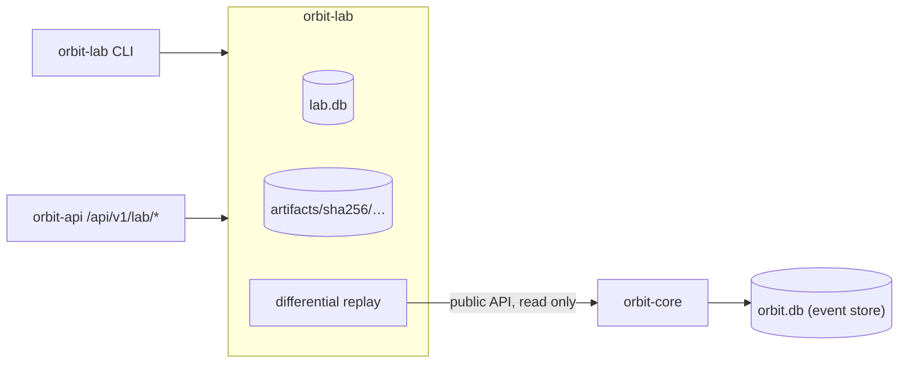

# The ORBIT lab: experiments, evidence and reproduction

`crates/orbit-lab` is the laboratory built on the event store:

- an **experiment registry** in its own SQLite database, with one enforced
  lifecycle for every kind and recovery of interrupted and abandoned runs;
- a content-addressed **artifact store**, verified on every read;
- **implementation identities** that tell apart two projection
  implementations sharing a name and version;
- **differential replay**: two implementations over one ordered history,
  with first-divergence diagnosis (this document);
- **reliability** scenarios ([RELIABILITY.md](RELIABILITY.md)), the
  **performance** lab ([PERFORMANCE.md](PERFORMANCE.md)) and **evidence
  bundles** with optional signatures ([EVIDENCE.md](EVIDENCE.md));
- a **launcher** that starts the separately built reliability runner for
  the API ([RELIABILITY.md](RELIABILITY.md#from-the-observatory-or-the-api-a-configured-runner)).

It is exposed through a library, an `orbit-lab` CLI, API endpoints and
the Observatory's **Experiments**, **Performance** and **Evidence** pages.

One registry and one lifecycle cover every experiment kind:

| Kind | Created with | Run by | Reproduced by |
|---|---|---|---|
| `differential_replay` | `Lab::create`, API, CLI `run` | the creating process (API: within the request) | re-execution against the event store, or from a bundle |
| `reliability` | `Lab::create_reliability` | only the `orbit-reliability` tool ([RELIABILITY.md](RELIABILITY.md)) | the same tool |
| `performance` | `Lab::create_performance`, API, CLI `measure` | the creating process (API: a background thread) ([PERFORMANCE.md](PERFORMANCE.md)) | a new, linked measurement |

Every kind shares the same components:
- the validated spec and its envelope digest;
- the build identity;
- the lifecycle, enforced by the database;
- an immutable completed result, or a structured failure;
- content-addressed artifacts;
- an append-only verification history, where every reproduction attempt
  gets one status from [`ReproductionStatus`](../crates/orbit-lab/src/reproduction.rs);
- export as a portable bundle ([EVIDENCE.md](EVIDENCE.md)).

Experiment failures (`history_unavailable`, `interrupted`, …) are kept
apart from failures of the experiment infrastructure (`infrastructure`),
and neither is ever recorded as a result.

Nothing here is a statistical or scientific claim. A differential replay
reports exactly what two pieces of code computed over one history.

## Boundary with `orbit-core`



- **One-way dependency.** `orbit-lab` depends on `orbit-core` and uses only
  its public API:
  - `EventStore::head`, `read_after`, `event` and `verify_stream`;
  - the `Projection` trait;
  - `state_digest`, `diff::diff` and `to_canonical_string`.

  `orbit-core` knows nothing about the lab. Its code, event format and schema
  (v3) are unchanged.
- **Read only.** The lab never writes to an event store. The CLI refuses to
  create a missing store.
- **Separate database.** Experiments live in `lab.db`, never in the event
  store. The two files have different `PRAGMA application_id`s:
  - the store is `ORBT`;
  - the lab is `ORLB`.

  Neither can be opened as the other; tests cover both directions.
- **No duplicated engine.** The lab doesn't reimplement storage, integrity
  checking, digests or diffs; it calls the core for them. It does not replace
  `ReplayLab` either. That compares current code with a trace recorded under
  the same `ProjectionKey`, while the lab compares two live implementations.

## Directory layout

```text
<lab dir>/lab.db                       registry (SQLite, WAL, synchronous=FULL)
<lab dir>/artifacts/sha256/ab/cdef…    artifact bytes, named by their SHA-256
<lab dir>/artifacts/tmp/               in-progress artifact writes
<lab dir>/locks/<experiment id>.lock   held while an experiment runs
<lab dir>/locks/<experiment id>.create held by its creator until it starts
<lab dir>/performance-work/<id>/       a running measurement's files (removed after)
<lab dir>/reliability-work/<id>/       a running scenario's files (removed after)
```

The default lab directory is `data/lab`, next to the default `data/orbit.db`.
Change it with `--lab` or `ORBIT_LAB_DIR`. `data/` is git-ignored.

## Registry

### Schema (version 4)

| Table | Purpose |
|-------|---------|
| `experiments` | One row per experiment. See the columns below. |
| `artifacts` | `digest` (PK), `media_type`, `size`, `created_at`. One row per distinct content. |
| `experiment_artifacts` | `(experiment_id, role)` → `digest`. Links are only accepted while the experiment is `running`. |
| `verifications` | Append-only history of checks: `kind` is `artifacts` or `reproduction`, plus `status`, `detail` and `verified_at`. Only finished experiments can be verified. |
| `imported_bundles` | v4. One row per imported evidence bundle, keyed by bundle digest; never updated or deleted, and never mixed with `experiments` ([EVIDENCE.md](EVIDENCE.md)). |
| `bundle_verifications` | v4. Append-only reproduction attempts of imported bundles. |

`experiments` columns:

| Group | Columns |
|-------|---------|
| Identity | `id` (16-byte UUIDv7), `kind`, `spec_version`, `spec` (canonical JSON), `spec_digest` |
| Input request | `stream_id`, `left_impl`, `right_impl` |
| Implementations | `implementations`: both descriptors, canonical JSON |
| Software | `orbit_version`, `git_commit`, `executable_digest` (v2; `NULL` for older rows) |
| Lifecycle | `status`, `created_at`, `started_at`, `finished_at`, `elapsed_micros` |
| Outcome | `input` (the resolved range), `outcome`, `result`, `result_digest`, `reproducibility` |
| Failure | `failure` (`{kind, message, details}`) |

Initialization works the same way as the event store's. A new or empty file
is migrated to the latest version. A file holding any other schema, or another
application id, is refused (`NotALabRegistry`). A newer version is refused
(`UnsupportedSchemaVersion`). Migrations run in order, each in one
transaction:

| Version | Sprint | Change |
|---------|--------|--------|
| 1 | 7 | Tables, triggers and constraints above |
| 2 | 8 | Adds `experiments.executable_digest` and adds it to the immutable identity columns (the trigger is recreated). Existing rows keep `NULL`. |
| 3 | 9 | Adds the kind `reliability` ([RELIABILITY.md](RELIABILITY.md)). For it, `stream_id`, `left_impl`, `right_impl` and the completed `input` are optional; differential replays still require them (a `CHECK`). SQLite cannot alter a `CHECK`, so `experiments` is rebuilt: triggers are dropped, rows copied, triggers recreated unchanged. Migrations run with foreign keys off, followed by `PRAGMA foreign_key_check`; any violation refuses to open. |
| 4 | Phase 9 | Adds the kind `performance` (same optional columns as `reliability`) by rebuilding `experiments` the same way, an index on `(kind, id)`, and the append-only `imported_bundles` and `bundle_verifications` tables. Existing rows are copied unchanged. |

Sprint 7 registries open unchanged in content (v1 → v2 → v3 → v4). A test loads a real Sprint 7
registry, event store and artifacts (`tests/fixtures/sprint7/`, dumped from
commit `a44e62f`), migrates it, reads every record, verifies its artifacts and
reproduces its experiments.

Representation:

- Timestamps are integer microseconds since the Unix epoch, UTC. They appear
  in JSON as RFC 3339 with six fractional digits and `Z`.
- Ids are UUIDv7, so they sort by creation time, and listing is newest first
  with a `before` cursor.
- Digests are 32-byte blobs, hex in JSON.
- JSON columns hold canonical JSON: sorted keys, no whitespace.

### Lifecycle

```text
created ──▶ running ──▶ completed
   │           │
   └───────────┴──────▶ failed
```

- **`created`.** The spec has been validated against the catalog, and both
  implementation descriptors and the build are recorded.
- **`running`.** Execution has started. The process holds the experiment's
  lock file.
- **`completed`.** A result is stored. Divergences and implementation errors
  are *results*, so they complete.
- **`failed`.** The experiment could not be carried out. A structured failure
  is stored, with a `kind` from this table:

  | Kind | Meaning |
  |------|---------|
  | `history_unavailable` | Missing stream, or too few events |
  | `integrity_failure` | The stream fails verification; nothing was replayed |
  | `invalid_range` | The requested range is not valid for this stream |
  | `implementation_unavailable` | The implementation is not registered, or its fingerprint changed |
  | `interrupted` | The run stopped before finishing |
  | `abandoned` | The process that created it stopped before starting it (see below) |
  | `infrastructure` | A reliability scenario or a performance workload could not set itself up; says nothing about the system under test |
  | `internal` | Any other error, including a performance iteration that returned a wrong result |

Only these transitions exist. They are enforced twice:

- `Registry` uses conditional `UPDATE … WHERE status = …` statements and
  returns `InvalidTransition`.
- Triggers reject any other update, even from raw SQL:
  `experiments_lifecycle`, `experiments_identity_is_immutable`, and the
  no-delete and no-update triggers on every table.

A `CHECK` constraint ties each status to its columns: a `completed` row
always has a result, input, digest and reproducibility; a `failed` row always
has a failure and never a result. Completing, which writes the artifact links
and the result, is one `BEGIN IMMEDIATE` transaction.

**Interrupted experiments.** A running experiment holds an exclusive OS file
lock on `locks/<id>.lock` (`std::fs::File::try_lock`), which the OS releases
however the process ends. `Lab::open` checks every `running` experiment:

- If its lock can be taken, no process is executing it any more, so it is
  marked `failed` / `interrupted`.
- If the lock is held, it is still running in another process and is left
  alone.

A partially executed experiment is never marked `completed`.

<a id="abandoned-experiments"></a>**Abandoned experiments.** Every
`create_*` takes an exclusive lock on `locks/<id>.create` *before* the
registry row exists, and keeps it until the experiment starts. `Lab::open`
(`recover_abandoned`) marks a `created` experiment `failed`/`abandoned` when
that file exists and its lock can be taken, meaning its creator is gone.
The update applies only while the row is still `created`, so a started
experiment is never touched. A live creator, however long it waits, keeps
its lock.

To let another process run a created experiment, call `Lab::release(id)`:
it deletes the file before unlocking, and the experiment becomes unowned,
which is never abandoned automatically. Experiments created by versions
without creation locks have no file either and are left alone.

Dropping a `Lab` without running what it created releases the locks. The
next recovery then marks those experiments abandoned.

**Work directories.** A performance measurement or reliability scenario
works in `<lab>/performance-work/<id>/` or `<lab>/reliability-work/<id>/`
and removes it when it ends. If its process is killed, `Lab::open` removes
the directory once the experiment is no longer `running`. Tests:
`tests/abandonment.rs`, plus the real-process case
`experiment_created/process_killed`.

**Concurrency.** Several `Registry` values, in one process or several, may
use one `lab.db`. Writes use `BEGIN IMMEDIATE` and wait up to 5 s for the
lock. A test runs four registries, each with its own connection, in parallel
threads, writing 100 experiments with no lost writes. Since Sprint 9 the
`registry-concurrency` reliability scenario also tests separate OS processes
(up to 8 × 25 experiments), racing starts and racing recoveries; see
[RELIABILITY.md](RELIABILITY.md#registry-concurrency-guarantees).

**Lab fault points.** `run_after_start`, `run_after_execute`,
`artifact_after_partial_write` and `run_before_complete`
(`crates/orbit-lab/src/fault.rs`) can be acted on only with the `reliability`
feature, which `orbit-api` never enables. `Lab::run_locked` holds the
lifecycle, lock and fault points for every experiment kind.
`Lab::open_without_recovery` opens without recovering, for tools that need
to observe recovery.

## Implementation identity

`orbit-core`'s `ProjectionKey` (name and declared version) names a *contract*,
and two pieces of code can declare the same one. Sprint 6 demonstrated this
with `DriftingCounter` in `tests/replay.rs`. The lab therefore identifies an
implementation by an `ImplementationDescriptor`:

| Field | Meaning |
|-------|---------|
| `id` | Stable, unique registry identifier, `[a-z0-9][a-z0-9._-]*`, up to 128 bytes. **The only unique key.** |
| `name` | Display name. Not unique. |
| `projection` | Declared `ProjectionKey`. Not unique. |
| `adapter` | `orbit-core/projection` for Rust `Projection` values |
| `implementation_type` | `std::any::type_name` of the Rust type |
| `config`, `config_digest` | Configuration value and its canonical digest. The built-ins have `{}`. |
| `determinism` | `pure` (follows the `Projection` contract) or `uncontrolled` |
| `fingerprint` | `ORBIT-LAB-IMPLEMENTATION-V1` digest over every field above |

The built-in catalog (`Catalog::builtin`):

| Id | Name | Projection | Code |
|----|------|------------|------|
| `orbit.counter` | Counter | `counter@1` | `orbit_core::projection::examples::Counter` |
| `orbit.inventory` | Inventory | `inventory@1` | `orbit_core::projection::examples::Inventory` |
| `orbit.merge-patch` | JSON merge patch | `merge-patch@1` | `orbit_core::projection::MergePatch` |
| `example.counter-floor-at-zero` | Counter | `counter@1` | `orbit_lab::variants::CounterFloorAtZero`. Decrements stop at 0. |
| `example.inventory-untracked-shipments` | Inventory | `inventory@1` | `orbit_lab::variants::InventoryUntrackedShipments`. Shipments don't add to `shipped_total`. |

The two `example.*` entries share a name and a projection key with a core
projection but have different ids, types and fingerprints. They exist to
demonstrate and test the lab.

**What the fingerprint guarantees, and what it does not:**

- It changes whenever any identity field changes: id, name, projection,
  adapter, type, configuration or determinism. Tests cover each one.
- It is independent of JSON member order.
- It does **not** hash source or machine code, so editing an implementation's
  body without changing its id, type or configuration leaves the fingerprint
  unchanged. A test documents this.
- It is not a statement about behaviour. Different fingerprints may compute
  identical states; only running them, which is what differential replay
  does, shows that.
- `std::any::type_name` is not guaranteed stable across compiler versions.
- The build (`orbit_version` and `git_commit`) is recorded with every
  experiment but kept *out of* the fingerprint, so fingerprints stay
  comparable across commits. `git_commit` is captured at build time by
  `crates/orbit-lab/build.rs`, or from `ORBIT_GIT_COMMIT`; uncommitted
  changes are not detected.

### Identity layers and completeness

Every experiment record carries an `identity` assessment, derived from what
was stored and never stored itself. It keeps four things apart:

| Layer | What it is | Where |
|-------|------------|-------|
| Declared | id, name, projection key, adapter, type name, determinism, and the `fingerprint` over them | each descriptor |
| Configuration | `config_digest` over the canonical configuration | each descriptor |
| Build | `orbit_version`, `git_commit` (build time) and `executable_digest`: SHA-256 of the running executable, read once per process from `std::env::current_exe()` | the experiment's build |
| Completeness | how much of the above is known | `identity.completeness`, `identity.gaps` |

| Completeness | Meaning |
|--------------|---------|
| `executable` | The digest of the binary that ran is recorded. It identifies the exact compiled code, including uncommitted changes, but for **every** implementation at once: any change anywhere in the program changes it. A file replaced on disk after the process started is not detected. |
| `source_revision` | Only the Git commit is known (Sprint 7 records). Uncommitted changes and the build environment are not captured. |
| `declared` | Neither is known. A code change that keeps the declared fields is invisible. |

`gaps` lists, in words, what the identity does not capture. No layer claims
semantic equivalence. Source code is not discovered or hashed at run time;
that would be unreliable for compiled Rust.

The build is recorded when the experiment is created; `create_and_run`
(used by the CLI and the API) creates and runs in the same process.
Reproduction reports `same_executable` (`true`, `false`, or `null` when either
digest is unknown) next to its classification. A different executable does not
by itself make a reproduction fail; only the results decide that.

An experiment stores both descriptors when it is created. A run or
reproduction is refused (`implementation_unavailable`) when an implementation
is no longer registered, or its current fingerprint differs from the
recorded one.

## Differential replay

### Specification

```json
{
  "stream": "counter-demo",
  "left": "orbit.counter",
  "right": "example.counter-floor-at-zero",
  "from": 0,
  "to": null,
  "reference": "left",
  "determinism_check": true
}
```

| Field | Required | Default | Meaning |
|-------|----------|---------|---------|
| `stream` | yes | — | The stream to replay |
| `left`, `right` | yes | — | Implementation ids |
| `from` | no | 0 | First compared boundary |
| `to` | no | the head when the experiment runs | Last boundary. The resolved value is pinned in the result. |
| `reference` | no | none | `"left"` or `"right"` marks that side as expected |
| `determinism_check` | no | `true` | Execute each side twice |

Unknown fields are rejected, so a request cannot smuggle in a file path or
anything else. The stored spec has every default written out. Its digest
(`ORBIT-LAB-SPEC-V1`, over the canonical form) is therefore the same however
a client orders members or omits defaults.

### Algorithm

1. **Resolve and pin the input.**
   1. Read the head and resolve `to`, checking `from <= to <= head` and
      `to <= 100,000` (the core's replay cap).
   2. Verify the **whole stream** with `verify_stream`. A damaged stream
      fails the experiment (`integrity_failure`) before any implementation
      runs.
   3. Record the digests of events `from` and `to`. Event digests are
      chained, so the digest of event `to` pins every event `1..=to`.
   4. Compute `history_fingerprint` (`ORBIT-LAB-HISTORY-V1`) over the stream,
      the range and both boundary digests.
2. **Run both implementations in lockstep.**
   1. Each implementation starts from its own initial state, in a fresh
      instance that owns its state.
   2. Events `1..=to` are read in pages of 1,000, in sequence order. Each one
      is checked for continuity: sequence `n + 1`, and a `prev_digest` equal
      to the previous event's digest.
   3. The *same* `&StoredEvent` value is applied to left, then right, so both
      receive identical ordered input. `events_fed_digest`
      (`ORBIT-LAB-EVENTS-V1`) records the ordered digests fed to them.
3. **Compare at every boundary** `from <= b <= to` (see
   [Boundaries and intervals](#boundaries-and-intervals)): both states are
   serialized with `serde_json` and compared by `state_digest`, which is
   SHA-256 over canonical JSON. Both digests are appended to the traces, and
   the timeline is updated as described below.
4. **Stop at the first failure.** An implementation fails by rejecting an
   event, panicking, or producing a state that cannot be serialized. Panics
   are caught with `catch_unwind`. Both sides stop there, and the failure,
   with its side, boundary and event, is the result.
5. **Check determinism** (on by default). Each implementation runs again,
   alone, on a fresh instance, over exactly the events it saw. Its trace and
   failure must be identical.

### Boundaries and intervals

- **Boundary `b`** is the state **after** applying events `1..=b`.
  Boundary 0 is the initial state, before any event. Only boundaries
  `from..=to` are compared.
- **Equal** means equal `state_digest`s: the canonical JSON (sorted keys,
  no whitespace, serde_json number formatting) of the two serialized states
  is byte-identical.
- **A divergence at boundary `b`** means the states differ after event `b`.
  At the first compared boundary there is no earlier comparison, so the
  states may already have differed before it.
- **A divergence interval** is a maximal run of consecutive differing
  boundaries `first..=last`. It ends in one of three ways:
  - `converged`: equal again at `converged_at = last + 1`, the boundary
    after `convergence_event`;
  - `open_at_end`: still different at `to`;
  - `stopped_by_failure`: an implementation failed while the states differed.
- **The timeline** (`result.timeline`) lists every interval in order (up to
  1,000; `intervals_total` and `intervals_truncated` say if there are
  more), with `convergences` and `final_equal`. `boundaries_differing` counts
  every differing boundary.
- **Diagnosis at important boundaries.** The first 20 intervals carry a full
  comparison at their first boundary (`entry`) and, when longer than one
  boundary, at their last (`exit`):
  - the event, with id, type, schema version, digest, `recorded_at` and
    metadata **keys** (values are not copied: they may be sensitive);
  - both state digests and canonical sizes;
  - the structural diff (up to 200 changes plus the total);
  - a `change_summary`: added, removed, modified, and modified with a
    different JSON type.

  Later intervals list boundaries only.
- **Every boundary's** digest pair is in the trace artifacts. `Lab::trace`
  (CLI `trace`, API `GET …/trace`) pages through them with an `equal` flag
  and links each boundary to its event.

Full states are not stored for every boundary. In memory the lab holds the
current pair of states, plus, while a diagnosed interval is open, the pair at
its latest differing boundary (to produce the `exit` diff).

### Diagnosis: evidence and open questions

`result.diagnosis` has two lists:

- **`evidence`:** facts read from the comparison. For example: where the
  states first differ and after which event, how many paths differ and of
  which kind, how many intervals and convergences there were, the final
  equality, and failures.
- **`not_established`:** what those facts do not show. Always why the states
  differ; whether the cause is in the event's handling or in earlier hidden
  state; and which side is correct. Without a reference: neither is assumed.
  With one: the reference is taken as expected by request, and the lab does
  not check it.

The lab never states a cause.

`result.perspective` gives the reading of sides and diffs: `reference`,
`expected`, `observed`, and `changes_orientation: "left_to_right"` (a
change's `from` is the left value, `to` the right value).

**Outcomes:**

| Outcome | Meaning |
|---------|---------|
| `equivalent` | Equal at every compared boundary |
| `reconverged` | Differed at some boundaries, equal at `to` |
| `diverged` | Different at `to` |
| `implementation_failed` | At least one side failed. Comparison stopped. |
| `nondeterministic` | Two executions of one side disagreed. Its comparison is not meaningful. |

**Terminology.** Without a `reference`, the result describes *differences
between implementations*; neither is called wrong. With a reference, that
side is labelled *expected* and the other *observed*. Diffs always read
left → right.

### Artifacts

| Role | Content | When |
|------|---------|------|
| `left_trace`, `right_trace` | 32-byte state digests, one per compared boundary, in order | always |
| `first_divergence_states` | `{"left": …, "right": …}`, both full states at the first divergence | if the states diverged |
| `final_states` | `{"left": …, "right": …}` at `to` | if neither side failed |

The result itself (`result`, digest `ORBIT-LAB-RESULT-V1`) contains no ids,
build details or timings of the run. Running the same experiment again on the
same input therefore yields the same document and the same digest.
Wall-clock time is stored separately, in `elapsed_micros`.

**Result versions.** `result_version` 2 (Sprint 8) adds `semantics`,
`perspective`, `timeline` and `diagnosis`, change summaries and richer event
context, and replaces Sprint 7's `divergent_segments`. Sprint 7 results have
no `result_version` (version 1) and stay as they were stored; the
Observatory shows their segments as intervals whose end was not recorded.
`semantics.version` (1 in both) names the comparison rules: boundary
meaning, canonical state comparison, the diff algorithm and the limits.

### Determinism assumptions

- **What the lab controls:** the order of events, which is sequence order;
  the input bytes, pinned by digests; fresh, unshared state per execution;
  and state comparison by canonical JSON, so the order of map members, such
  as `HashMap` iteration, never causes a false difference.
- **What it cannot control:** Rust code cannot be sandboxed, so an
  implementation can read clocks, globals, randomness, files or the network.
  The double execution detects many of these. A test uses a global counter.
  It can only *disprove* determinism, never prove it, so a dependency that
  happens to return the same value twice goes unnoticed.
- **Declared dependencies:** an implementation that declares
  `determinism: uncontrolled` is never reported as reproducible.
- **Floats:** serde_json writes them in shortest round-trip form. `-0.0` and
  `0.0` serialize differently, so they count as different. Non-finite floats
  serialize as `null`, which can hide a difference.

`reproducibility` takes one of three values:

- **`reproducible`:** the input is pinned and both sides gave identical traces
  on two executions.
- **`unverified`:** the check was disabled.
- **`not_reproducible`:** an implementation was nondeterministic or declares
  uncontrolled dependencies.

The `reasons` field says why.

### Reproducing and verifying

- **`Lab::reproduce`** (CLI `reproduce`, API `POST …/reproduce`) re-executes a
  completed differential replay and compares it with the original
  (performance experiments are measured again instead, see
  [PERFORMANCE.md](PERFORMANCE.md)). The statuses below are shared by
  every kind and by bundles (`ReproductionStatus`, which adds
  `inconclusive` and `unsupported`). Nothing is
  substituted. Checks run in this order, and the first that fails decides:

  | Status | Meaning |
  |--------|---------|
  | `configuration_mismatch` | The stored spec no longer matches its digest or cannot be read by this version; the result was produced under different comparison rules (`semantics.version`); or the recorded range exceeds this build's event limit |
  | `not_reproducible` | The original was classified `not_reproducible`, or the re-execution was nondeterministic |
  | `implementation_unavailable` | An implementation is not registered, or its fingerprint changed |
  | `history_unavailable` | The stream is missing, too short, or fails verification |
  | `history_changed` | The events at the recorded boundaries have different digests (e.g. another store with a same-named stream) |
  | `artifact_missing` | A recorded artifact is missing or damaged, so the original evidence cannot be compared (Phase 9) |
  | `reproduced` | Same result (below) |
  | `differs` | A different result. `detail.differences` names what differs: `left_trace`, `right_trace`, `result_document`, or summary fields. |

  "Same result" means both re-executed traces have the recorded artifact
  digests, and:
  - for a result of the current layout, the result document has the same
    digest (`detail.compared: "full_result"`);
  - for a Sprint 7 result, a version-independent summary matches
    (`"traces_and_summary"`): outcome, input, events fed, counts, first
    divergence and final digests, failures.

  `to` is pinned to the recorded value, so events appended later don't
  matter. `detail.build` records both builds and `same_executable`, and
  `detail.identity_completeness` the identity level. Only completed
  experiments can be reproduced; failed or unfinished ones return
  `InvalidState` (API 409) and record nothing.
- **`Lab::verify_artifacts`** (CLI `verify`, API `POST …/verify`) re-hashes the
  stored spec and result and every artifact file, and checks that each trace
  holds exactly 32 bytes per compared boundary. Each artifact is `intact`, `missing` or
  `corrupted`, and the overall status is `intact` or `damaged`. The check is
  recorded.

The registry does not copy event histories. Local reproduction needs the
same event store. If that history is gone or damaged, the lab says so and
does not claim the result is reproducible. An evidence bundle exported while
the store still holds the history carries events `1..=to`; a differential
replay can then be reproduced from the bundle alone, over the verified
events ([EVIDENCE.md](EVIDENCE.md)).

### Artifact safety

- Paths are derived only from a digest, never from request input. No API or
  spec field names a file.
- Writes go to `tmp/`, are `fsync`ed and then renamed into place. A later
  write of the same bytes replaces a damaged file. Each temporary file is
  locked by its writer until it is renamed. `Lab::open` deletes temporary
  files whose lock it can take, which belong to interrupted writers, and
  keeps live ones.
- Every read re-hashes the content and refuses a mismatch. Symbolic links are
  treated as missing and never followed.
- Records and API responses contain digests, sizes and media types. They
  never contain local paths, which a test checks.
- Artifacts hold only states and digests. No environment variables, host
  names or user names are recorded.

## Running it locally

These commands use a store with a `counter-demo` stream of three events:
+2, −5, +1.

```bash
cargo run -p orbit-lab -- implementations
cargo run -p orbit-lab -- run --stream counter-demo \
    --left orbit.counter --right example.counter-floor-at-zero --reference left
cargo run -p orbit-lab -- list
cargo run -p orbit-lab -- show <id>
cargo run -p orbit-lab -- verify <id>
cargo run -p orbit-lab -- reproduce <id>
cargo run -p orbit-lab -- trace <id> --from 1 --limit 3
```

`--db` (default `$ORBIT_DB_PATH` or `data/orbit.db`) and `--lab` (default
`$ORBIT_LAB_DIR` or `data/lab`) select the files. `run --spec FILE.json` reads
a spec from a file. Output is JSON.

Excerpt from an actual run of exactly this history with the Sprint 8 build,
on 2026-10-18 (abridged; `…` marks omitted fields):

```json
{
  "outcome": "diverged",
  "reproducibility": "reproducible",
  "identity": { "completeness": "executable", "…": "…" },
  "result": {
    "result_version": 2,
    "boundaries_compared": 4,
    "boundaries_differing": 2,
    "first_divergence": {
      "boundary": 2,
      "boundaries_matched_before": 2,
      "changes": [{ "path": "/value", "op": "modified", "from": -3, "to": 0 }],
      "change_summary": { "added": 0, "removed": 0, "modified": 1, "type_changed": 0 }
    },
    "timeline": {
      "intervals": [{ "index": 1, "first": 2, "last": 3, "end": "open_at_end", "…": "…" }],
      "intervals_total": 1,
      "convergences": 0,
      "final_equal": false
    },
    "perspective": { "reference": "left", "expected": "left", "observed": "right", "changes_orientation": "left_to_right" },
    "diagnosis": {
      "evidence": [
        "The states were equal at 2 compared boundaries and first differ at boundary 2, after event #2 (counter.decremented, schema v1).",
        "…"
      ],
      "not_established": [
        "Why the states differ. The first differing boundary is where a difference first becomes visible in the serialized states, not necessarily where it was caused.",
        "…"
      ]
    }
  }
}
```

`trace <id> --from 1 --limit 3` returned boundaries 1 (equal), 2 and 3
(differ), and `reproduce` returned `reproduced` with `compared:
"full_result"`, no differences, and `same_executable: true`.

The same flow works through the API (`docs/API.md`, "Lab endpoints") and in
the Observatory under **Experiments**.

## Resource limits

| Limit | Value | Why |
|-------|-------|-----|
| Events per experiment | 100,000 (`MAX_EVENTS`, the core's replay cap) | bounds traces and time |
| Trace artifacts | 32 bytes per compared boundary per side: at most 3.2 MB each | every boundary stays inspectable |
| Intervals listed | 1,000 (`MAX_RECORDED_INTERVALS`), plus the total | keeps the result document bounded |
| Intervals with diffs | 20 (`MAX_DIAGNOSED_INTERVALS`) | each diff needs both full states |
| Changes per comparison | 200 (`MAX_RECORDED_CHANGES`), plus the total | bounds large state diffs |
| Trace page | 1,000 entries in the library; 500 through the API (its page cap) | bounded responses |
| States in memory | the current pair, plus one more pair while a diagnosed interval is open | no per-boundary state retention |
| Executable digest | read and hashed once per process, starting in the background when the lab opens | build identity without per-experiment cost |

One measurement, not a benchmark: `cargo run --release -p orbit-lab --example
large_history -- 100000` on an Apple M3 (8 GB, macOS 27.0.1), 2026-10-18. It
builds a 100,000-event stream in which the counter and its floor variant
diverge and converge 10,000 times, then runs one differential replay.

- The replay, including the determinism re-execution, took 0.65 s.
- Peak resident memory of the whole process was 36.5 MB, including building
  the store.
- The traces were 3.2 MB each.
- The result document was 409 KB: 1,000 listed intervals, 20 of them with
  diffs.

This is one run on one machine. Times depend on the projections, state sizes
and storage.

The executable digest costs one read and hash of the binary per process. In
the first CI run of Sprint 8, a debug build hashed it on the first request,
with unoptimized SHA-256, and an end-to-end assertion timed out. `sha2` is
now optimized in dev builds (`[profile.dev.package.sha2]` in `Cargo.toml`),
and the hash starts when the lab opens. Locally, with a 34 MB debug
`orbit-api`, the first experiment request went from 0.46 s to 0.011 s
(one measurement each, the second with the background hash already finished).

## Known limitations

- **One adapter.** Rust `Projection`s compiled into the binary are the only
  implementations. There is no plugin loading.
- **Lockstep from 0.** Both sides always fold from event 1. Snapshots are not
  used, because a snapshot is one implementation's state.
- **The whole stream is verified,** including events after `to`. Damage
  anywhere refuses the experiment.
- **Up to 100,000 events.** See [Resource limits](#resource-limits).
- **Divergence is located, not explained.** The first differing boundary
  shows where the states first differ, not why.
- **Positional array diffs**, as in the core.
- **The fingerprint does not cover code bodies** (see above), and the
  determinism check can disprove determinism but cannot prove it.
- **Reproduction needs the event history,** from the original store or from
  a bundle that includes it.
- **Identity is coarse at its best.** The executable digest covers the whole
  binary, not one implementation, and Sprint 7 records have none.
- **Only completed experiments have traces.** A failed experiment records no
  artifacts.
- **Synchronous differential runs.** `POST /lab/experiments` runs a
  differential replay synchronously. Past the request deadline the client
  gets `503 request_timeout`, while the experiment still finishes and is
  recorded. Performance runs are accepted and measured in the background.
  Neither can be cancelled.
- **Unkeyed digests.** Like the core's, they detect accidental corruption and
  naive edits, not a party able to rewrite both the files and the digests.
- **Rename durability.** Artifact directories are not `fsync`ed after rename,
  so a power loss may lose a just-written artifact. Verification would then
  report it `missing`.
