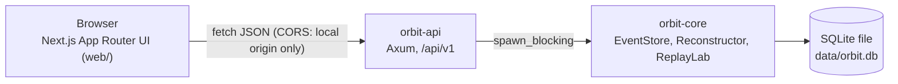
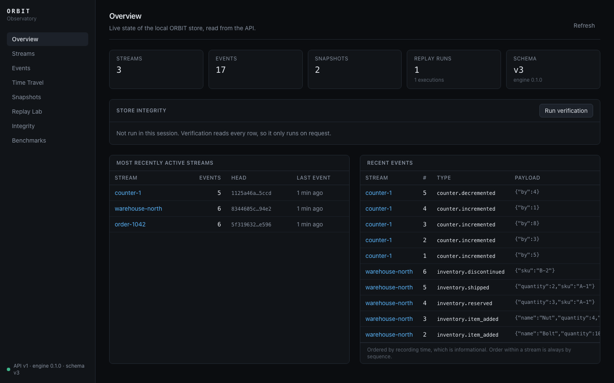
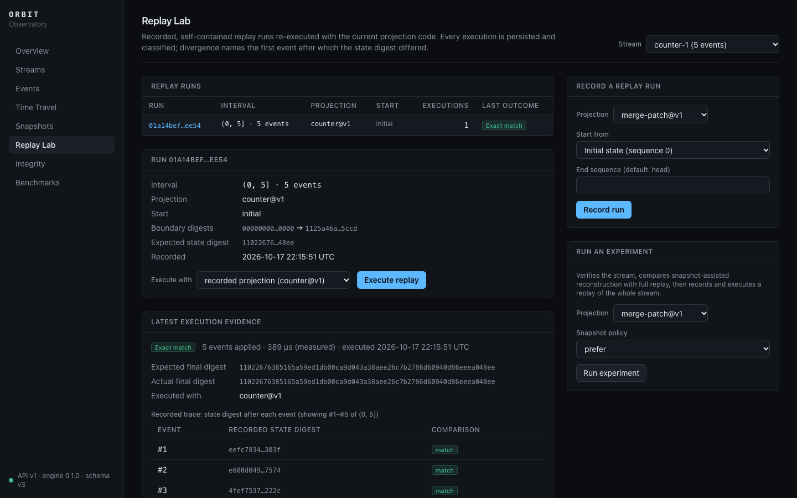
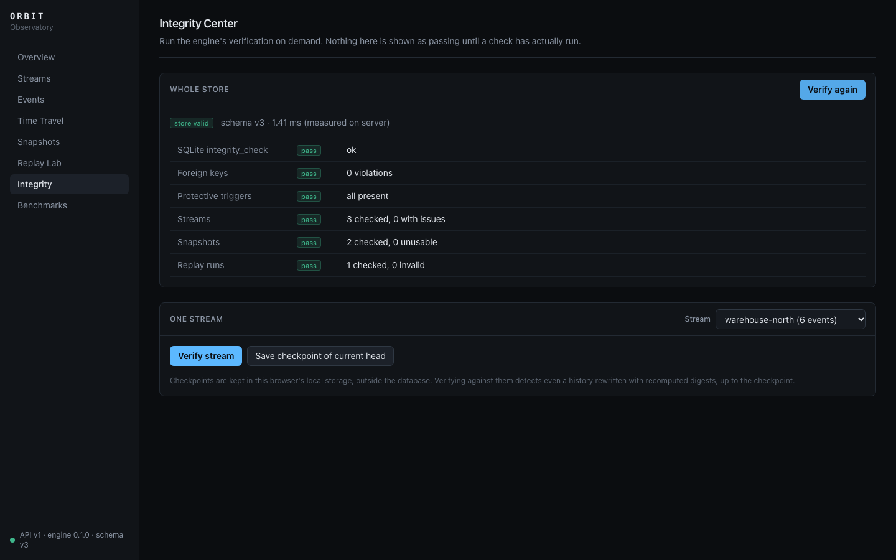

# ORBIT Observatory

The Observatory is ORBIT's local web interface. It is a Next.js application
(`web/`) that reads and writes everything through the `orbit-api` HTTP server.
That server runs the `orbit-core` engine over one SQLite file.



- **Rust core.** It is authoritative: ordering, validation, digests,
  reconstruction, snapshots, verification and replay.
- **API.** It handles transport: validation of HTTP input, error mapping,
  pagination, CORS, OpenAPI. See [API.md](API.md).
- **Frontend.** Its pages are client components that call the API through a
  typed client (`web/src/lib/api.ts`). There is no backend of its own, no
  mock data, and no server-side data fetching. A page with no data says so,
  and a failed request shows the API's error code, status and message with a
  retry button. Verification results are shown only after a check has actually
  run.

## Running it

```bash
# terminal 1: the API (creates data/orbit.db on first start)
cargo run -p orbit-api

# terminal 2: the web interface
cd web && npm ci && npm run dev        # http://localhost:3000

# optional: demonstration data, through the public API
scripts/seed-demo.sh
```

## Pages

| Page | What it shows | Engine operations used |
|------|---------------|------------------------|
| Overview | API health (polled), counts, most recently active streams, recent events, on-demand store verification | `statistics`, `recent_events`, `stream_summaries`, `verify_store` |
| Streams | Paged stream list, creation (with metadata), stream detail with links into every tool | `stream_summaries`, `create_stream`, `stream` |
| Events | Paged events in sequence order, event inspector (digest chain), append form with optional optimistic concurrency and a clear conflict message | `read_after`, `event`, `append` |
| Time Travel | Choose a projection and a sequence (slider), see the historical and current state side by side with start point, events applied and measured timings, the structural diff between them, and optionally per-event changes | `reconstruct`, `diff`, `explain` |
| Snapshots | Snapshots with live validation status (digest, history binding, projection key, decoding), event-digest binding, state; creation | `list_snapshots`, `check_snapshot`, `create_snapshot` |
| Replay Lab | Runs with their last outcome; recording (initial, snapshot or reconstructed start); execution with the recorded or another projection; evidence (classified outcome, expected and actual digests, first divergence with event id, final-state diff, violations, warnings, trace window); execution history; experiments | `ReplayLab::record`, `execute`, `inspect`, `experiment` |
| Integrity | Whole-store verification with one pass/fail row per check, and per-stream verification against checkpoints kept in the browser's local storage, i.e. outside the database | `verify_store`, `checkpoint`, `verify_stream_against` |
| Benchmarks | Criterion results (median with confidence interval, mean, throughput, measurement time) read from `target/criterion` | none (reads benchmark output files) |
| Experiments (Sprint 7) | Lab experiments with outcome and reproducibility; a form to run a differential replay (stream, left and right implementation, optional reference, last event); the stored result: both implementation identities and fingerprints, input range, first divergence with its event and structural diff, final-state diff, failures, artifacts; artifact verification and reproduction, with the verification history | `orbit-lab`: `Lab::create_and_run`, `experiment`, `verify_artifacts`, `reproduce` (through `/api/v1/lab/*`) |
| Experiments (Sprint 8 additions) | A divergence timeline over the compared boundaries (each interval is a keyboard-focusable control); evidence apart from what is not established; first-divergence navigation into a per-boundary trace window (digests, equal/differ, links to each event); expandable intervals with entry and exit diffs and the converging event; implementation identity with its completeness and gaps; reproduction details (what was compared, what differs, whether the executable is the same). Sprint 7 results are shown with their segments, marked as recorded before Sprint 8. Replay Lab links to it. | `orbit-lab` through `/api/v1/lab/*`, including `GET …/trace` |
| Experiments (Sprint 9 additions) | Reliability experiments next to differential replays: each case with a badge that says whether a real OS process was involved or the failure was simulated (or a test-only edit), whether the fault was observed and how, a table of expected versus observed invariants, recovery and integrity details, and what the scenario does and does not simulate; infrastructure failures are labelled as not being results. A read-only catalog of scenarios with the command that runs them: the page cannot start one. | `GET /api/v1/lab/reliability/scenarios`, `/api/v1/lab/experiments*` |

### Screenshots

These were captured from the running application, with data from
`scripts/seed-demo.sh`.

| | |
|---|---|
|  |  |
|  |  |

## A complete workflow

The end-to-end test (`web/tests/e2e/workflow.spec.ts`) automates exactly this,
against a real API and an empty, temporary database:

1. **Overview:** the health indicator reports the API, engine and schema versions.
2. **Streams:** create `order-1` with metadata.
3. **Events:** append `order.created`, `order.paid` and `order.item_removed`,
   then inspect event 2. With optimistic concurrency on, an append after
   another writer moved the head shows the conflict, with expected and actual
   heads.
4. **Time Travel:** reconstruct sequence 1 and compare it with the current
   state. The diff lists `/status`, `/total` and `/items/A`.
5. **Snapshots:** create a snapshot. It is listed as *usable* and bound to the
   digest of event 4. The next reconstruction starts from it.
6. **Replay Lab:** record a run, execute it, and get *exact match* with a
   matching trace. Executing it with another projection is reported as
   *unavailable* and is never substituted.
7. **Integrity:** verify the store (*store valid*), save a checkpoint, and
   verify the stream against it.

## Development

See [web/README.md](../web/README.md) for scripts and layout, and
[DEVELOPMENT.md](DEVELOPMENT.md) for the combined test commands.
